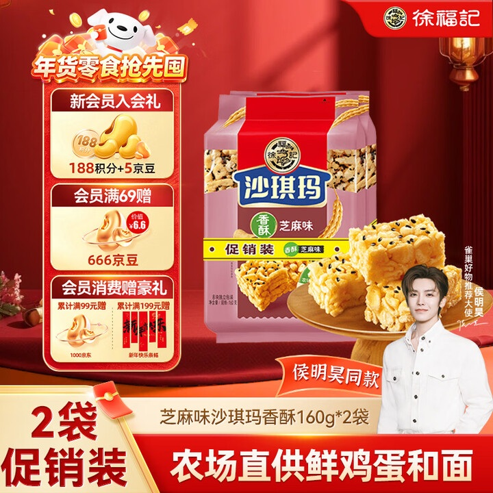
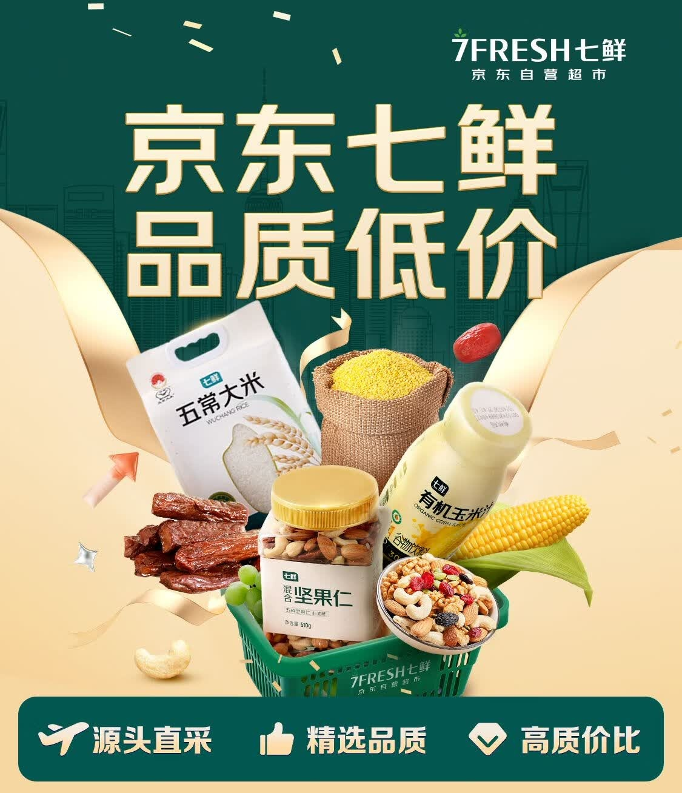
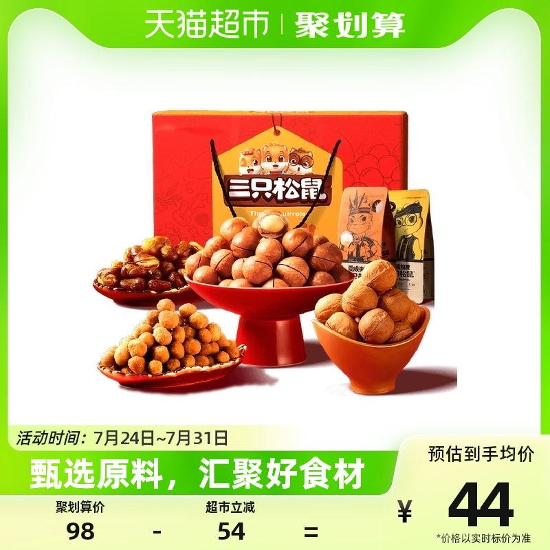
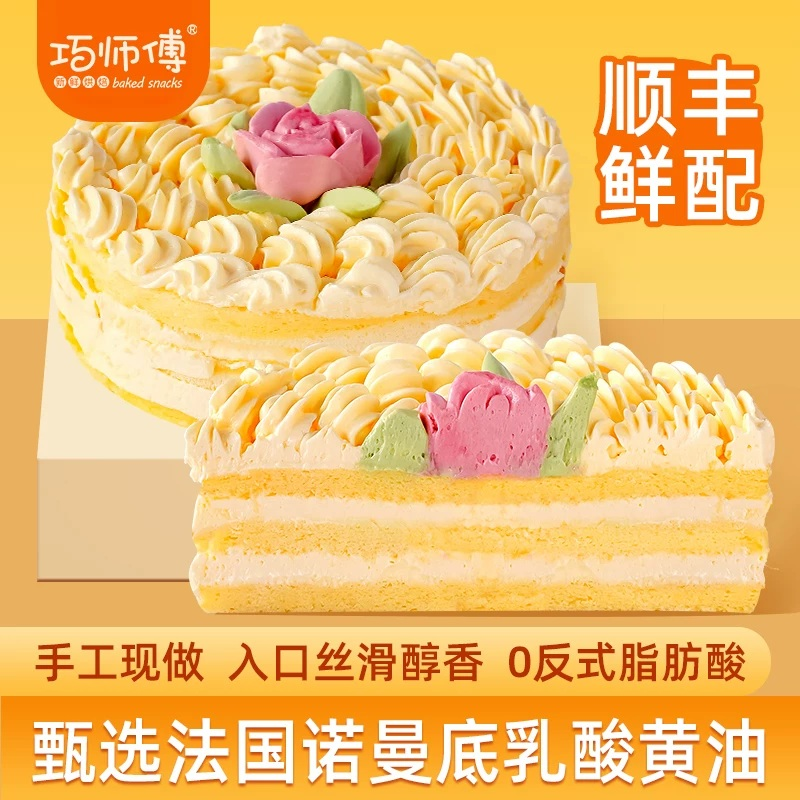

# 1_商品首图 · 食品零食 代表图

本组按商品呈现、信息组织和动线选取不同结构。占比为目测描述，不是排版指令。

## 1-093：包装糕点

用途：活动促销；参考角色：整图布局参考；标签：左右分栏;完整与细节并置;底部信息带

可借鉴：左侧竖向权益卡与右侧包装、实物分工，底栏承接规格

不适合照搬：人物代言和会员权益不能移植；密度不适合普通白底商品图

## 1-094：粮油零食混合

用途：店铺综合图；参考角色：整图布局参考；标签：字体主导;多商品组合;中心英雄

可借鉴：上半部用大字建立主题，下半部篮装商品形成品类锚点

不适合照搬：不能用综合篮装图证明单件商品配置或规格

## 1-097：坚果礼盒

用途：活动促销；参考角色：整图布局参考；标签：中心英雄;完整与细节并置;底部信息带

可借鉴：后方完整包装与前方不同坚果盘并置，价格集中右下

不适合照搬：不能照搬坚果种类、礼盒数量和价格计算

## 1-补构图185：烘焙蛋糕

用途：单品展示；参考角色：整图布局参考；标签：完整与细节并置;局部特写;非对称构图

可借鉴：完整蛋糕负责识别，切片在前让层次可见，短信息分别放右上和底部

不适合照搬：原料、配送及零反式脂肪酸宣称不可继承，切层需符合真实配方
