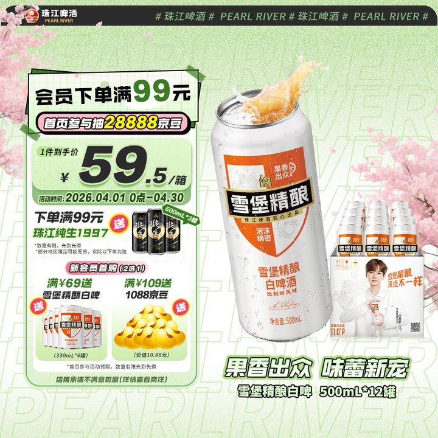
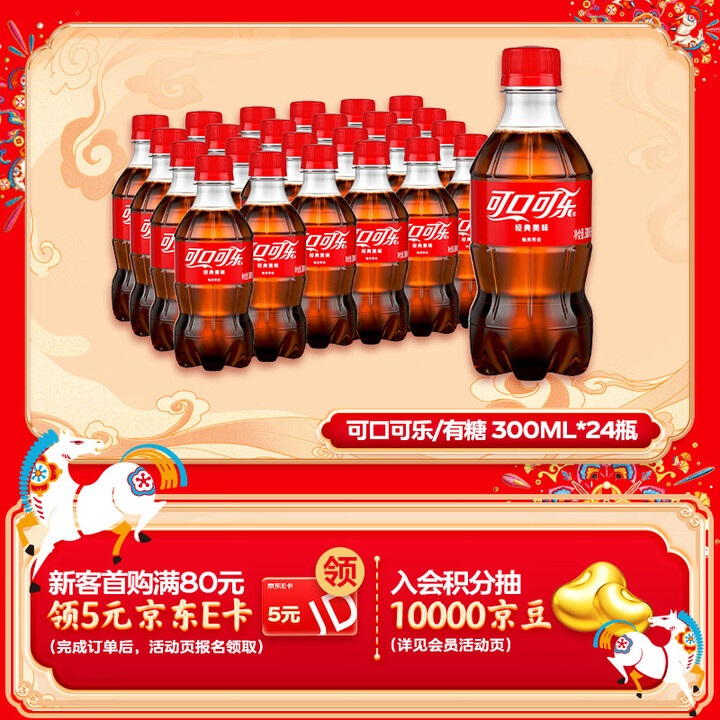
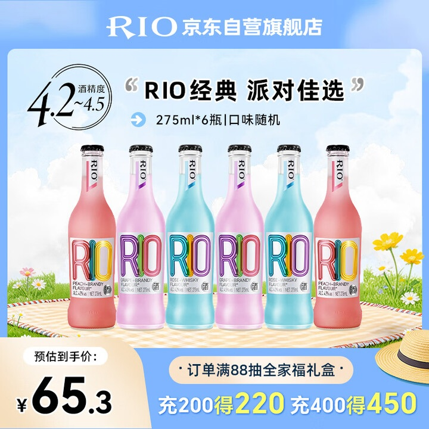

# 1_商品首图 · 酒水饮料 代表图

本组按商品呈现、信息组织和动线选取不同结构。占比为目测描述，不是排版指令。

## 1-083：罐装啤酒

用途：活动促销；参考角色：整图布局参考；标签：左右分栏;中心英雄

可借鉴：将大罐识别与左侧权益卡分开，右下小罐组合补充包装关系

不适合照搬：复杂赠品条款和泡沫效果不适合所有饮品

## 1-086：瓶装可乐整箱

用途：活动促销；参考角色：整图布局参考；标签：多商品组合;上下分区;底部信息带

可借鉴：用大瓶与后排瓶群表示单瓶形态和多瓶装关系，下部独立活动区

不适合照搬：瓶数不能当作新商品实际装箱数；活动券并非售价

## 1-087：鸡尾酒组合

用途：活动促销；参考角色：整图布局参考；标签：多商品组合;上下分区;俯视陈列

可借鉴：不同颜色瓶身等高排开，上方主题与下方价格互不遮挡

不适合照搬：随机口味与酒精度不能从参考继承；阵列不适合单瓶强调
