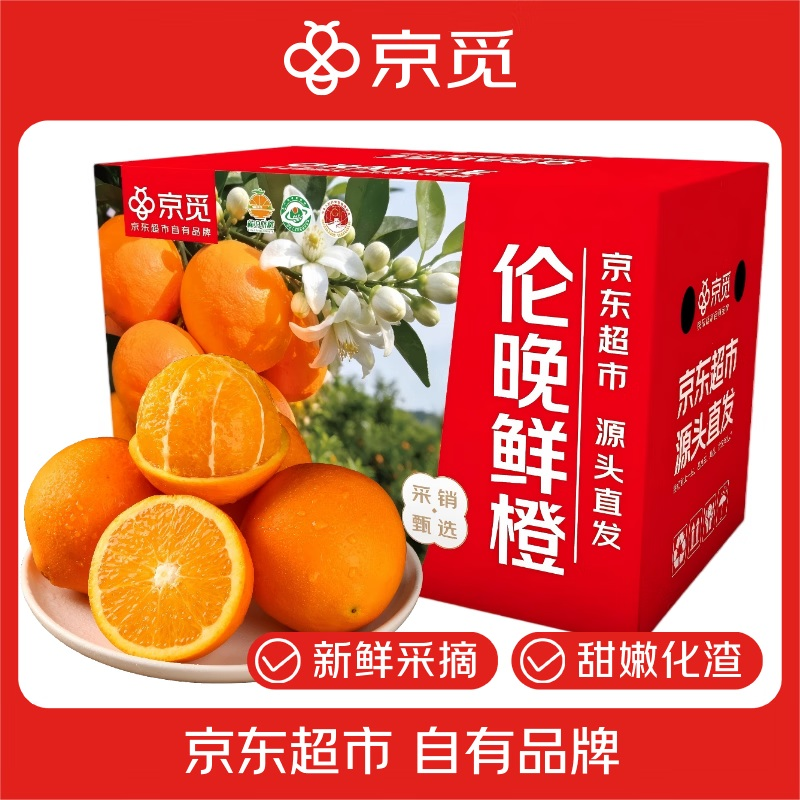
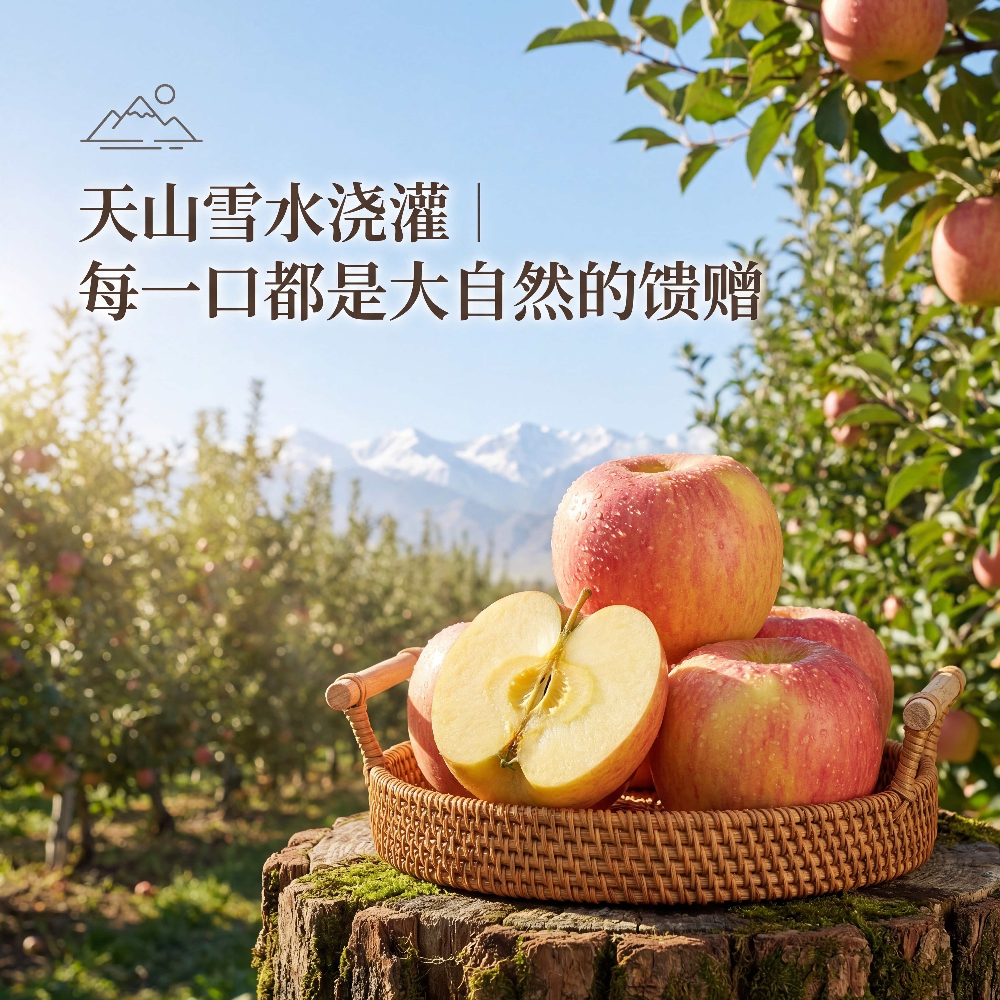

# 1_商品首图 · 生鲜农产品 代表图

本组按商品呈现、信息组织和动线选取不同结构。占比为目测描述，不是排版指令。

## 1-补004：箱装柑橘

用途：单品展示；参考角色：整图布局参考；标签：中心英雄;完整与细节并置

可借鉴：大箱建立规格识别，前景整果与切面补充可食形态

不适合照搬：包装上的产地与品质宣称不能移植到新水果

## 1-补010：番茄

用途：活动促销；参考角色：整图布局参考；标签：中心英雄;底部信息带

可借鉴：中央留出果实完整轮廓，下方主题与右下价格构成两个阅读点

不适合照搬：周年庆、吉祥物和优惠不适合无活动商品图

## 1-补构图105：苹果鲜果

用途：单品展示；参考角色：整图布局参考；标签：场景叙事;非对称构图;完整与细节并置

可借鉴：左上标题与右下果篮形成斜向阅读，切果在最前展示内部质地

不适合照搬：产地、灌溉方式与果肉外观必须取自实际商品资料
