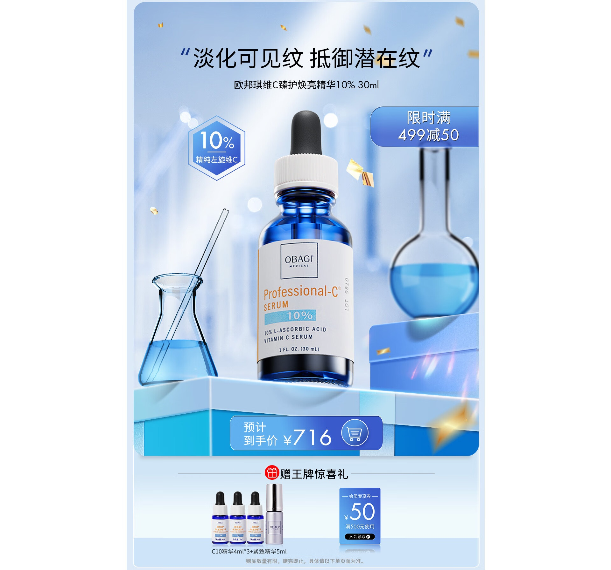
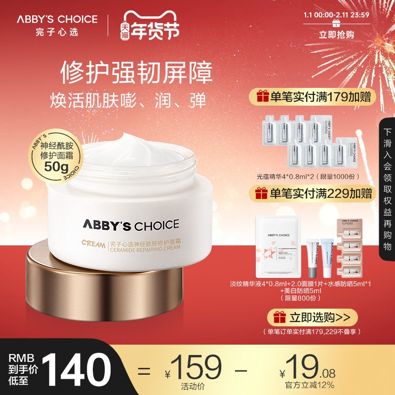
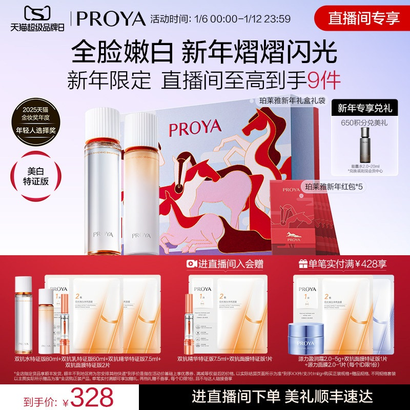

# 1_商品首图 · 美妆护肤 代表图

本组按商品呈现、信息组织和动线选取不同结构。占比为目测描述，不是排版指令。

## 1-003：滴管精华

用途：活动促销；参考角色：整图布局参考；标签：中心英雄;前后景分层;底部信息带

可借鉴：主瓶在内框中央，实验玻璃靠两侧，价格与赠品分两层置底

不适合照搬：实验意象不证明成分或功效；原素材纵向内框不能当尺寸标准

## 1-069：面霜

用途：活动促销；参考角色：整图布局参考；标签：非对称构图;局部特写;左右分栏

可借鉴：大罐与膏体在左侧形成第一视觉，右栏只承担赠品，底部独立算式

不适合照搬：赠品门槛与膏体质感需重新核实，右栏不宜照搬成常规卖点

## 1-071：护肤礼盒

用途：活动促销；参考角色：整图布局参考；标签：多商品组合;上下分区

可借鉴：中部完整礼盒做识别，下部把赠品压成独立横向队列

不适合照搬：主商品与赠品必须区别，不能沿用包装艺术和活动内容
