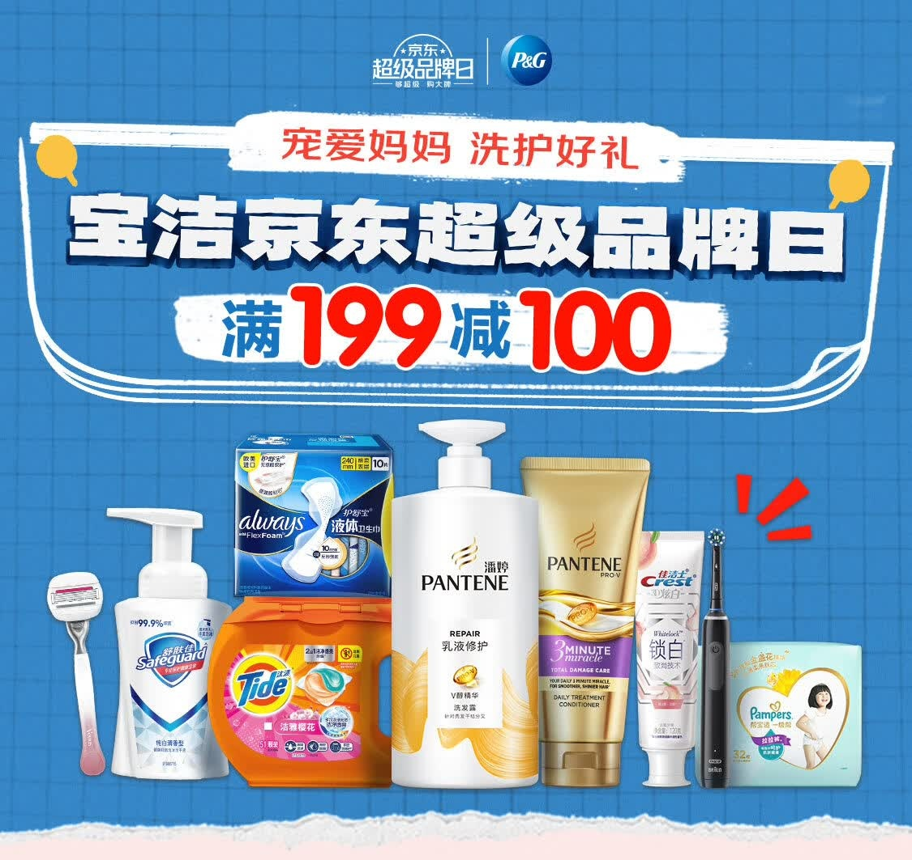
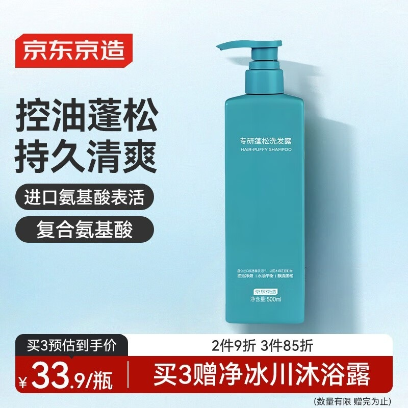
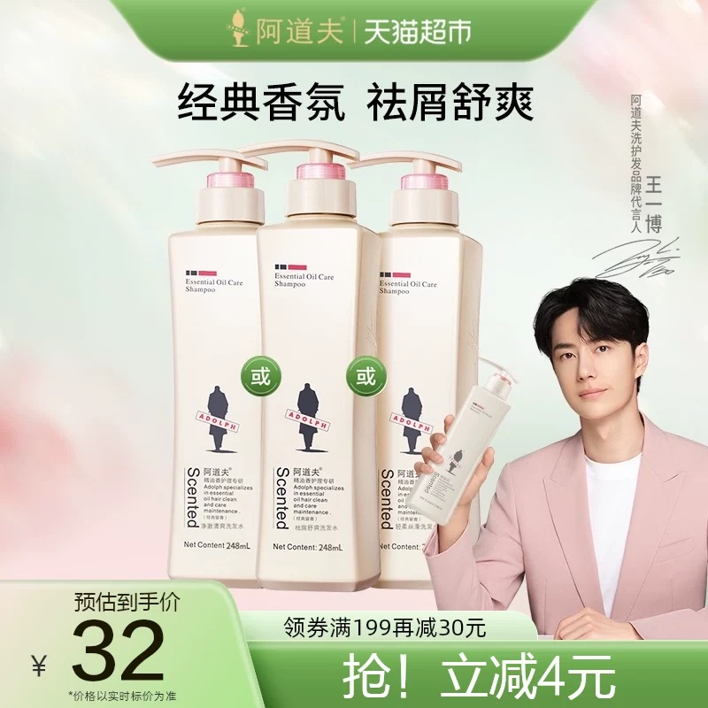

# 1_商品首图 · 个护清洁 代表图

本组按商品呈现、信息组织和动线选取不同结构。占比为目测描述，不是排版指令。

## 1-067：洗护清洁混合

用途：店铺综合图；参考角色：整图布局参考；标签：字体主导;多商品组合;上下分区

可借鉴：上半部集中活动主题，下半部不同包装按高度组合

不适合照搬：综合活动图不能用作一种洗发水的配置或性能说明

## 1-补构图035：洗发护理单品

用途：单品展示；参考角色：整图布局参考；标签：左右分栏;中心英雄

可借鉴：右侧完整瓶身不压文字，左侧标题到标签再到价格形成纵向顺序

不适合照搬：不能继承表活成分、功效或赠品规则

## 1-补构图036：洗发护理系列

用途：活动促销；参考角色：整图布局参考；标签：人物互动;多商品组合;非对称构图

可借鉴：大瓶解释购买对象，人物手中小瓶连接使用动作，底部统一活动信息

不适合照搬：代言身份与三瓶是否为一套均不可继承
