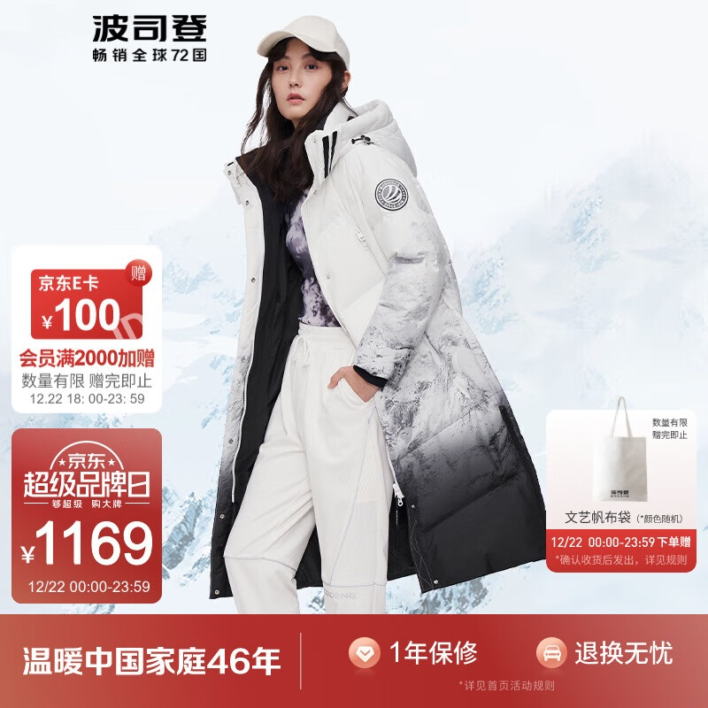
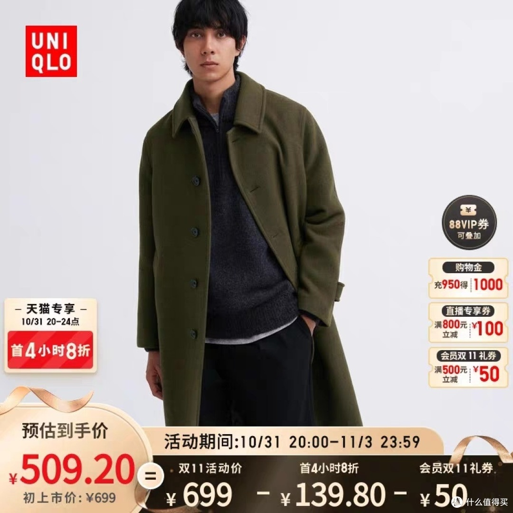
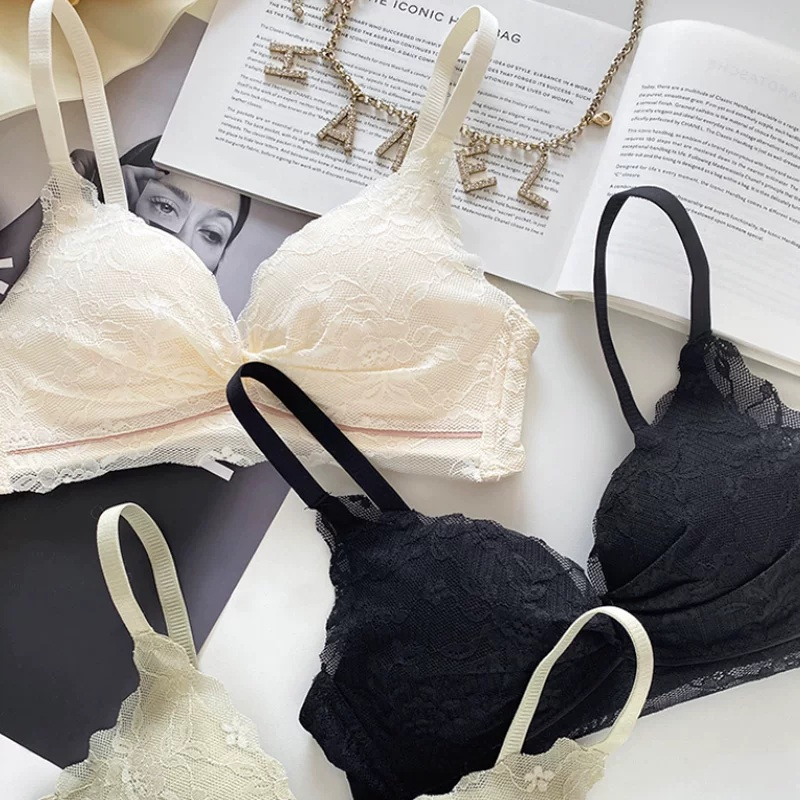

# 1_商品首图 · 服饰内衣 代表图

本组按商品呈现、信息组织和动线选取不同结构。占比为目测描述，不是排版指令。

## 1-051：长款羽绒服

用途：活动促销；参考角色：整图布局参考；标签：人物互动;场景叙事;非对称构图

可借鉴：衣服穿着轮廓保持连续，活动卡靠左避开衣身，底部仅承接服务

不适合照搬：人物、衣服印花与雪景不能原样复用；并非面料微距证据

## 1-054：男士大衣

用途：活动促销；参考角色：整图布局参考；标签：人物互动;上下分区;底部信息带

可借鉴：完整上身图与底部价格算式分开，使版型不被条款覆盖

不适合照搬：优惠算式与代言人物不能继承；侧栏会降低无活动图的简洁度

## 1-补构图047：蕾丝内衣

用途：单品展示；参考角色：整图布局参考；标签：俯视陈列;斜向动线;多商品组合

可借鉴：斜向平铺完整罩杯与肩带，颜色分组互相错开，靠边道具不夺主商品

不适合照搬：三个颜色不能当三件套，蕾丝花纹和配件事实必须保真
