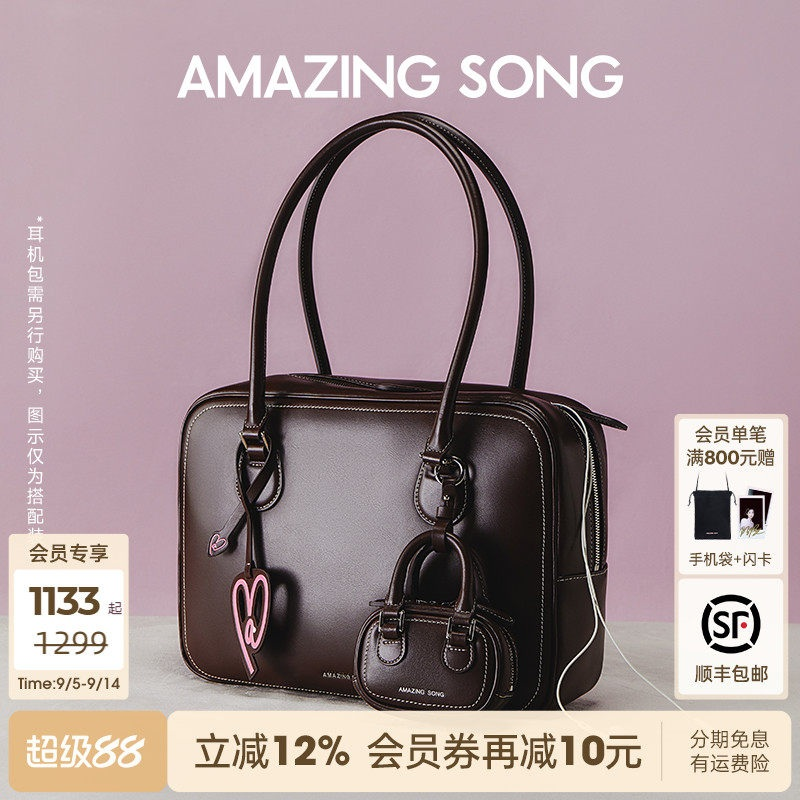
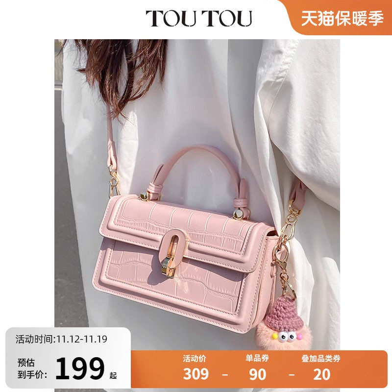
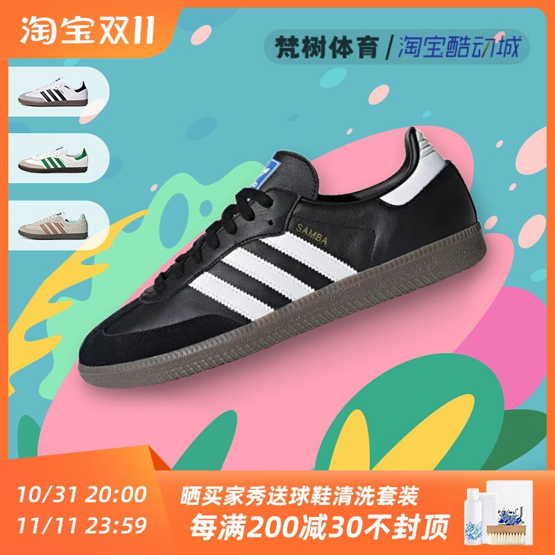

# 1_商品首图 · 鞋靴箱包 代表图

本组按商品呈现、信息组织和动线选取不同结构。占比为目测描述，不是排版指令。

## 1-052：手提包

用途：活动促销；参考角色：整图布局参考；标签：中心英雄;留白构图

可借鉴：长提手完整保留，顶部留白给品牌，两侧卡片不穿过包身

不适合照搬：会员礼物、包内小包和配件不能默认随商品提供

## 1-053：单肩手提包

用途：活动促销；参考角色：使用关系参考；标签：人物互动;局部特写;底部信息带

可借鉴：裁切人物保留包和提手，底部一条算式承接交易信息

不适合照搬：服装、挂件和价格不应照搬；照片不能证明内部容量

## 1-057：休闲运动鞋

用途：活动促销；参考角色：使用关系参考；标签：非对称构图;局部特写;多角度并置

可借鉴：一只大鞋作为识别，左侧小图提供色款，斜向形成动线

不适合照搬：抽象漂浮不适用于结构需要落地的大件；色款需来自实物
