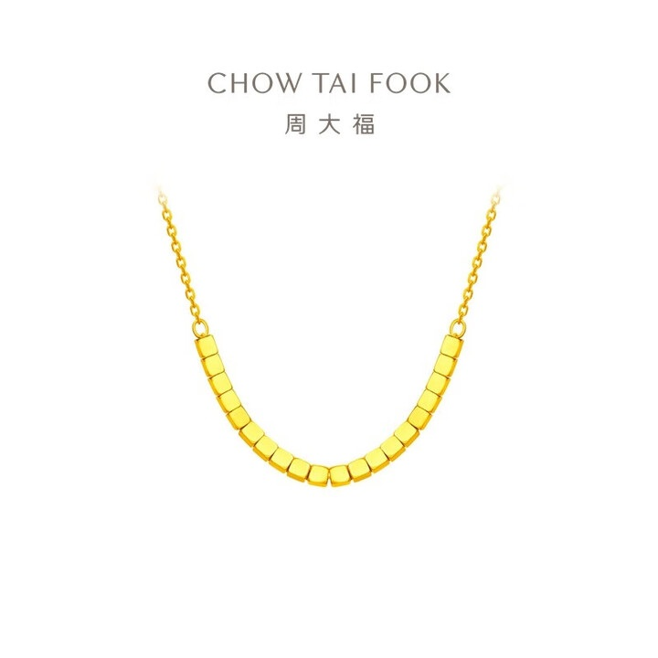
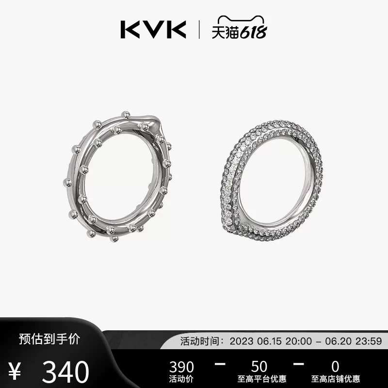
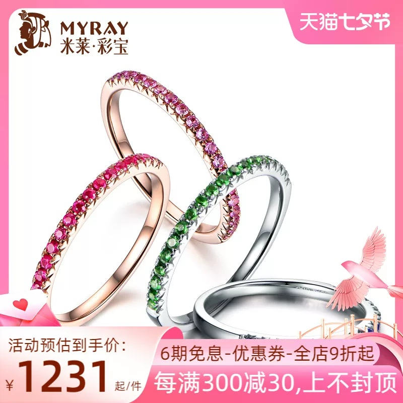

# 1_商品首图 · 珠宝钟表 代表图

本组按商品呈现、信息组织和动线选取不同结构。占比为目测描述，不是排版指令。

## 1-补038：黄金项链

用途：单品展示；参考角色：整图布局参考；标签：中心英雄;留白构图

可借鉴：弧形链条完整展示，顶部品牌与下方空白让链节纹理成为焦点

不适合照搬：大留白适合细长首饰，不应直接套到需要体积说明的大件

## 1-补构图170：组合戒指与结构对照

用途：单品展示；参考角色：整图布局参考；标签：左右分栏;结构展示

可借鉴：左右对照正背朝向露出镶口和环形轮廓，信息留在底条

不适合照搬：是否两件组合需核实，钻石数量、材质、价格不可继承

## 1-补构图171：彩宝叠戴戒指

用途：活动促销；参考角色：整图布局参考；标签：多商品组合;斜向动线;局部特写

可借鉴：不同角度戒指形成斜向连线，正面宝石与侧边戒圈同时可辨

不适合照搬：叠戴造型不能暗示所有戒指一起出售，宝石材质和数目不可沿用
