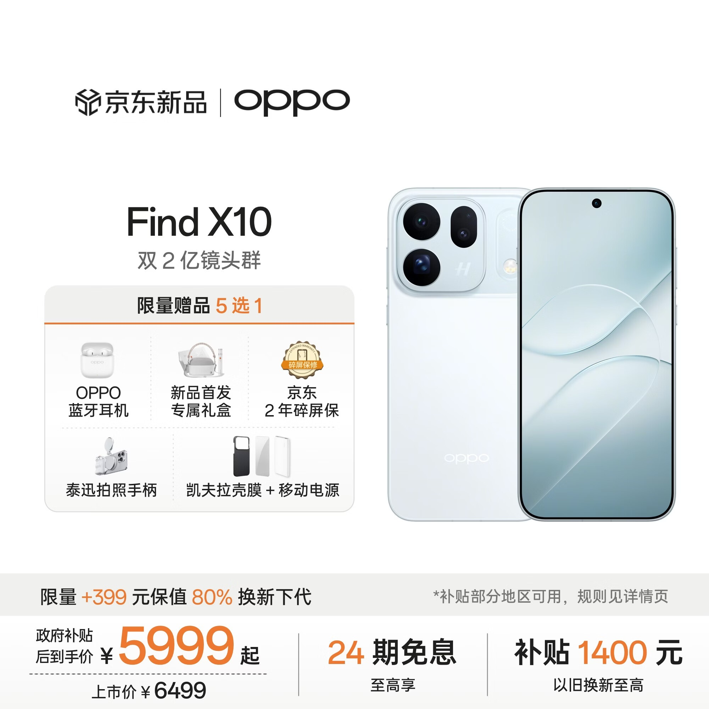
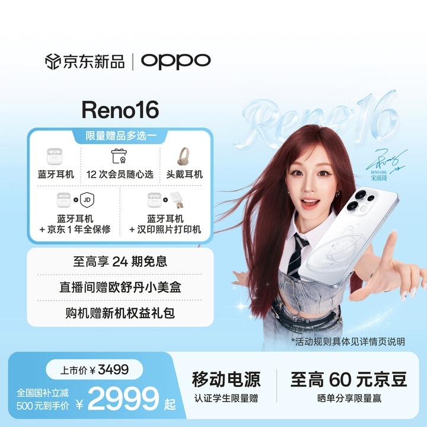
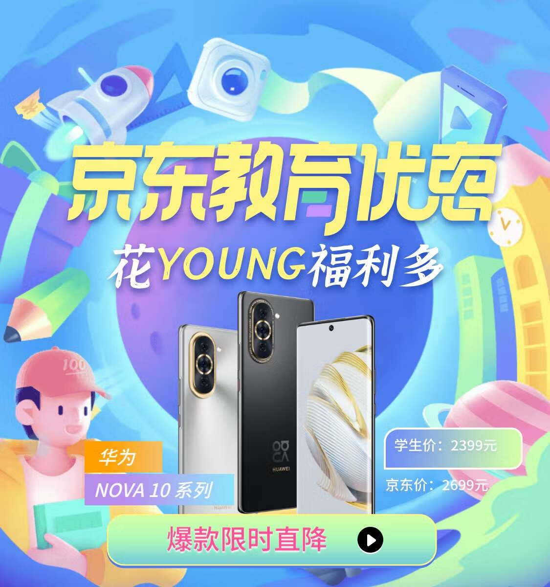

# 1_商品首图 · 手机数码 代表图

本组按商品呈现、信息组织和动线选取不同结构。占比为目测描述，不是排版指令。

## 1-035：手机

用途：活动促销；参考角色：整图布局参考；标签：左右分栏;多角度并置;底部信息带

可借鉴：右侧正背双机与左侧赠品网格互不交叉，底栏集中交易信息

不适合照搬：多机不代表出售两台；赠品、补贴和首发字样需重新核实

## 1-037：手机

用途：活动促销；参考角色：整图布局参考；标签：人物互动;左右分栏

可借鉴：人物握持手机占右侧，左侧规则区对齐，避免文字穿过面部

不适合照搬：人物占比高会削弱纯商品识别；不能借用代言或主张

## 1-040：手机

用途：活动促销；参考角色：整图布局参考；标签：字体主导;场景叙事;多商品组合

可借鉴：跨上半部的大标题先传达传播对象，下半部手机组保留商品识别

不适合照搬：卡通背景、教育优惠资格和型号不能照搬
