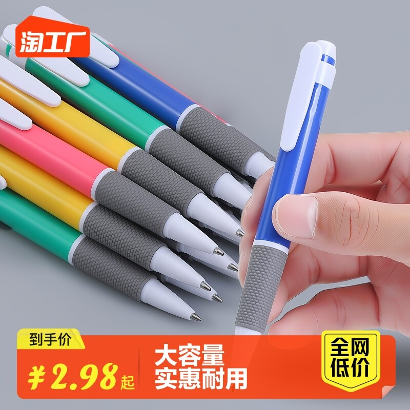
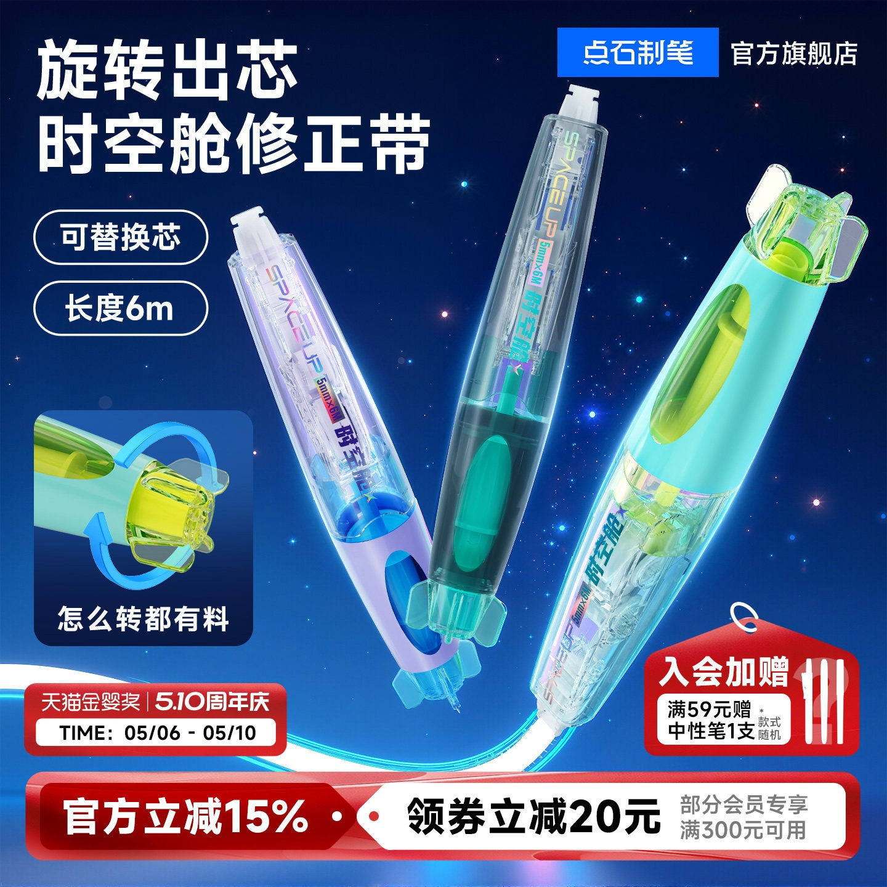

# 1_商品首图 · 电脑办公 代表图

本组按商品呈现、信息组织和动线选取不同结构。占比为目测描述，不是排版指令。

## 1-043：文具混合

用途：店铺综合图；参考角色：整图布局参考；标签：字体主导;左右分栏;参数卡片列

可借鉴：左侧主题与右侧活动日程分栏，信息阅读有明确顺序

不适合照搬：这是一张活动调度图，不适合替代具体笔或本子的商品首图

## 1-047：中性笔

用途：活动促销；参考角色：整图布局参考；标签：局部特写;人物互动;非对称构图

可借鉴：成排笔杆与一支手持笔并置，握柄纹理靠近镜头

不适合照搬：手部动作不证明书写效果；笔芯颜色和容量需真实资料

## 1-048：修正带

用途：活动促销；参考角色：整图布局参考；标签：非对称构图;完整与细节并置

可借鉴：完整透明主体与左下旋转机构小窗并置，标题避开产品内部

不适合照搬：结构剖视或机构细节必须有实拍支持；促销条款另填
