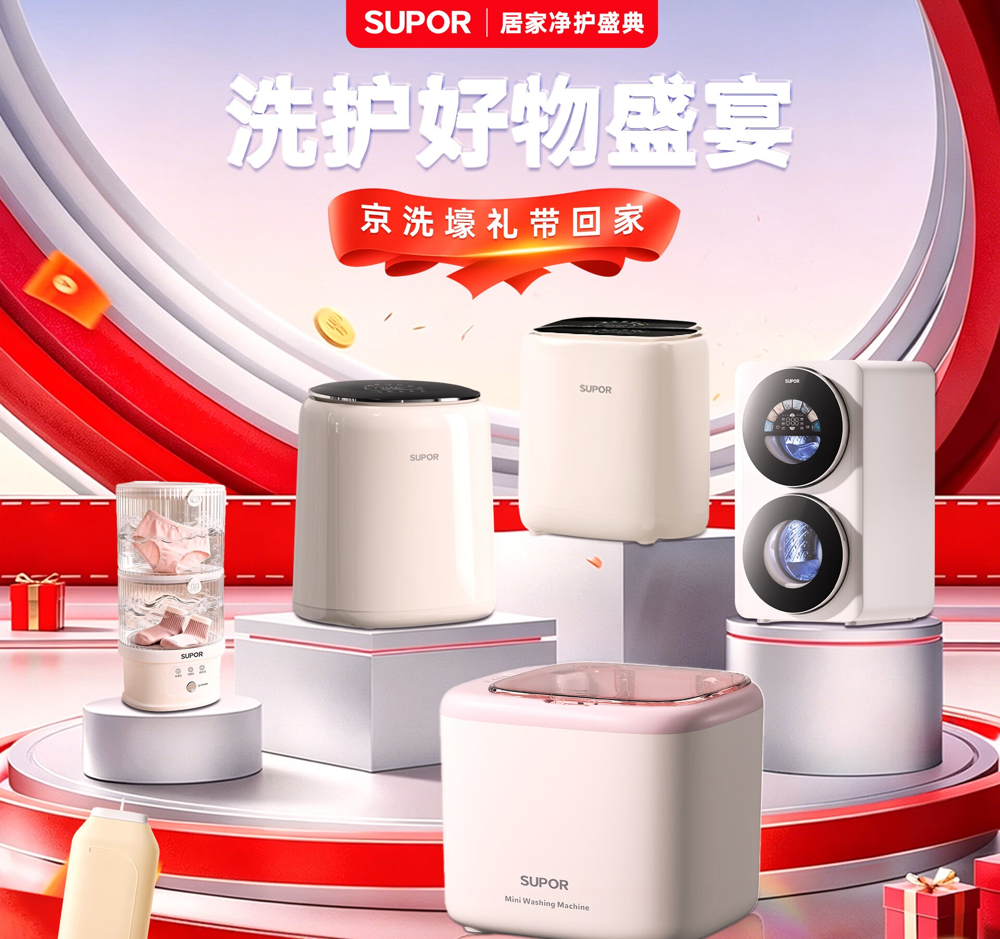
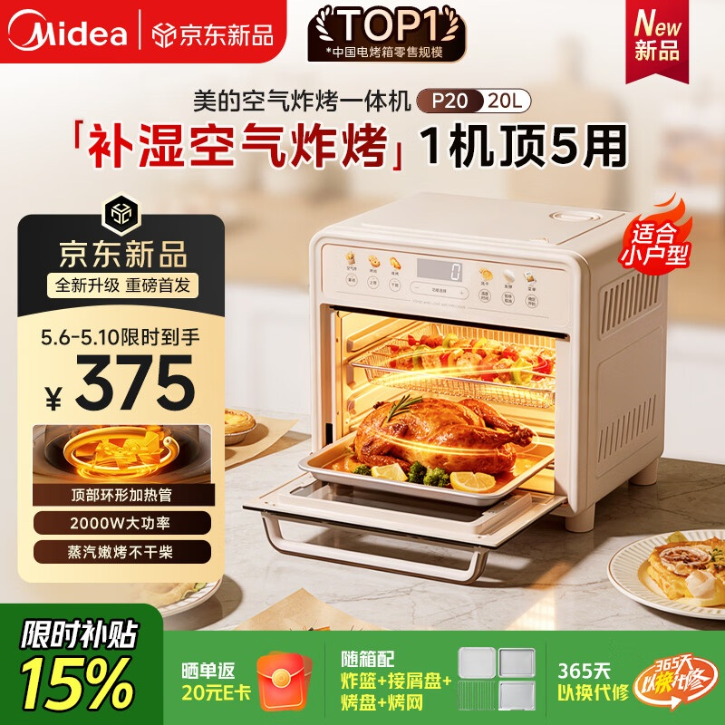
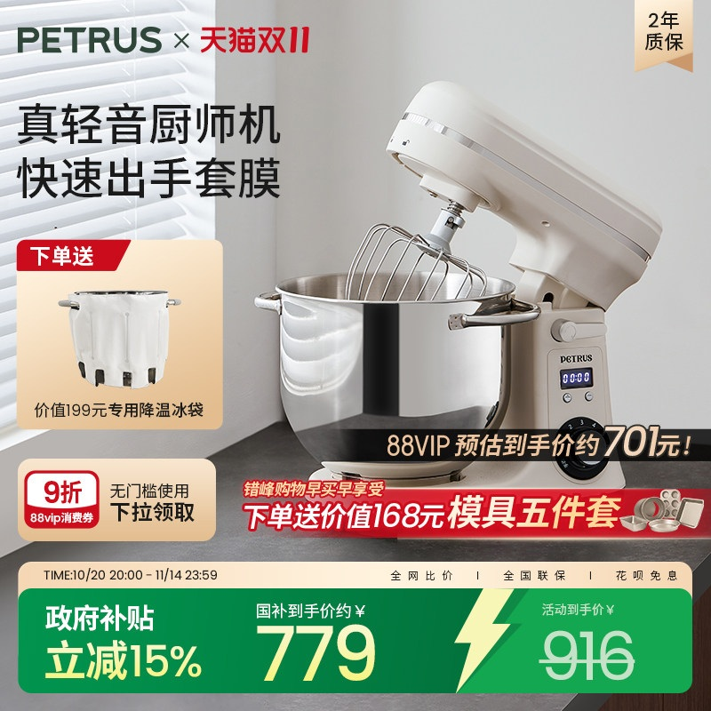

# 1_商品首图 · 家用电器 代表图

本组按商品呈现、信息组织和动线选取不同结构。占比为目测描述，不是排版指令。

## 1-009：洗护小家电组合

用途：品牌形象；参考角色：整图布局参考；标签：多商品组合;前后景分层

可借鉴：通过台座高差组织多设备，标题集中上部，保留产品的连续轮廓

不适合照搬：组合图不等于套装；不能借展台展示推断设备功能

## 1-011：空气炸烤箱

用途：活动促销；参考角色：整图布局参考；标签：左右分栏;完整与细节并置;场景叙事

可借鉴：开门完整外观与内部食物并置，左栏承担型号及参数

不适合照搬：内部食物、容量和套餐不能凭参考推断；加热效果须有依据

## 1-013：厨师机

用途：活动促销；参考角色：整图布局参考；标签：非对称构图;场景叙事;底部信息带

可借鉴：抬起机头露出搅拌头与钢盆，左侧文字不挡操作结构

不适合照搬：未确认抬头结构时不能照搬姿态；赠品不等于标准附件
