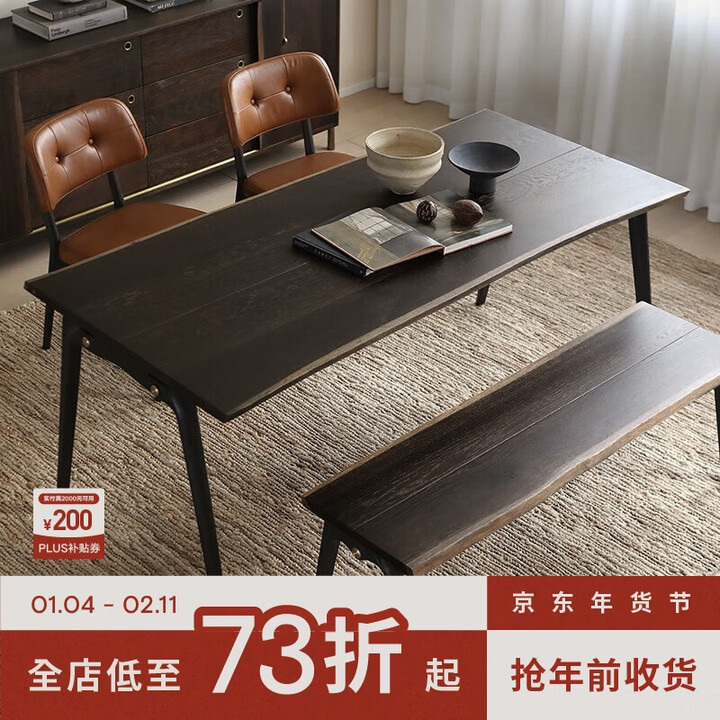
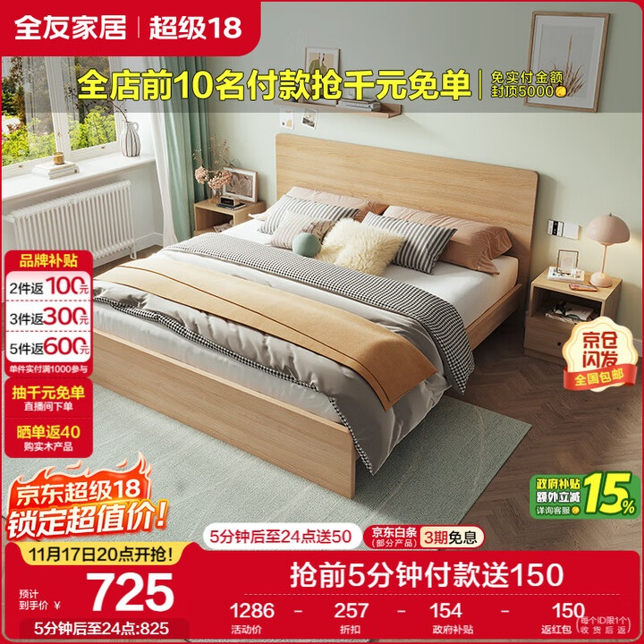
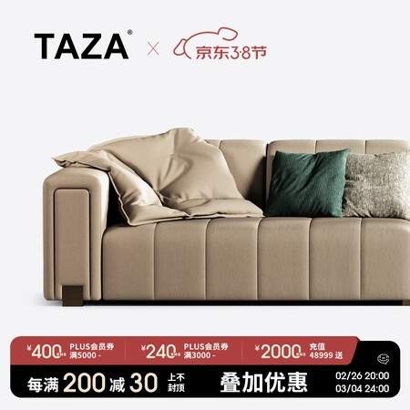

# 1_商品首图 · 家居家具 代表图

本组按商品呈现、信息组织和动线选取不同结构。占比为目测描述，不是排版指令。

## 1-028：餐桌椅

用途：活动促销；参考角色：整图布局参考；标签：场景叙事;局部特写;非对称构图

可借鉴：微俯角让桌面纹理与桌腿同时出现，促销集中底栏

不适合照搬：画面有裁切，不适合解释全部椅子数量或餐桌完整尺寸

## 1-029：木床

用途：活动促销；参考角色：整图布局参考；标签：场景叙事;左右分栏;底部信息带

可借鉴：整床以斜侧角展示，左券栏贴边，底部交易带不切断床轮廓

不适合照搬：床品、床头柜不一定随床出售；房间不能证明实物尺寸

## 1-030：沙发

用途：活动促销；参考角色：整图布局参考；标签：局部特写;留白构图;上下分区

可借鉴：局部沙发靠包与扶手占横向区域，顶部留白保持品牌优先

不适合照搬：裁切构图不适合承担整套家具尺寸或结构说明
