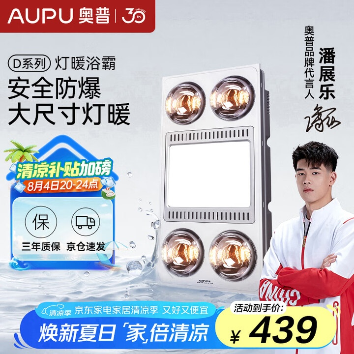
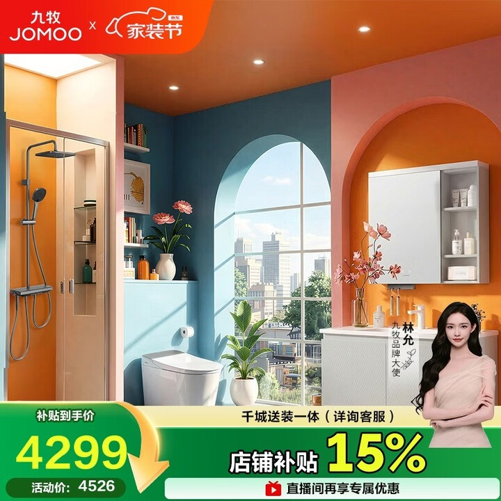
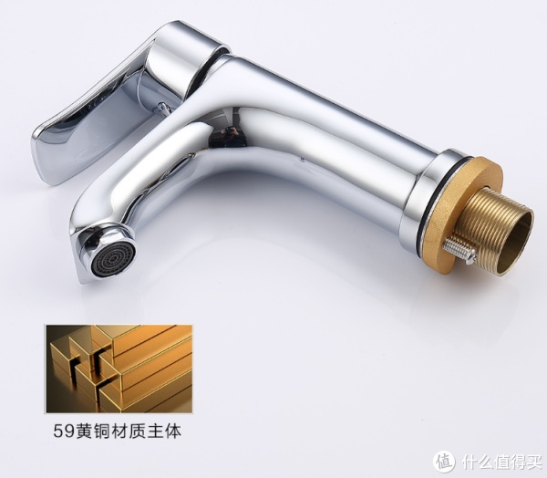

# 1_商品首图 · 家装建材 代表图

本组按商品呈现、信息组织和动线选取不同结构。占比为目测描述，不是排版指令。

## 1-补008：灯暖浴霸

用途：活动促销；参考角色：整图布局参考；标签：中心英雄;人物互动;左右分栏

可借鉴：浴霸保持完整，左侧简短卖点、右侧人物分开，价格置底

不适合照搬：未安装悬空图不能解释安装方式；代言与服务不得沿用

## 1-补051：卫浴成套

用途：活动促销；参考角色：整图布局参考；标签：场景叙事;多商品组合

可借鉴：多件卫浴放入统一建筑空间，底栏承接价格和服务

不适合照搬：不能默认是成套出售；安装、折扣、人物与品牌均需独立资料

## 1-补构图082：水龙头接口与材质细节

用途：单品展示；参考角色：局部机制参考；标签：局部特写;完整与细节并置;结构展示

可借鉴：横卧商品让平时被遮住的螺纹接口显露，下部切面框补充结构识别

不适合照搬：黄铜型号、电镀层与水印品牌不能继承
