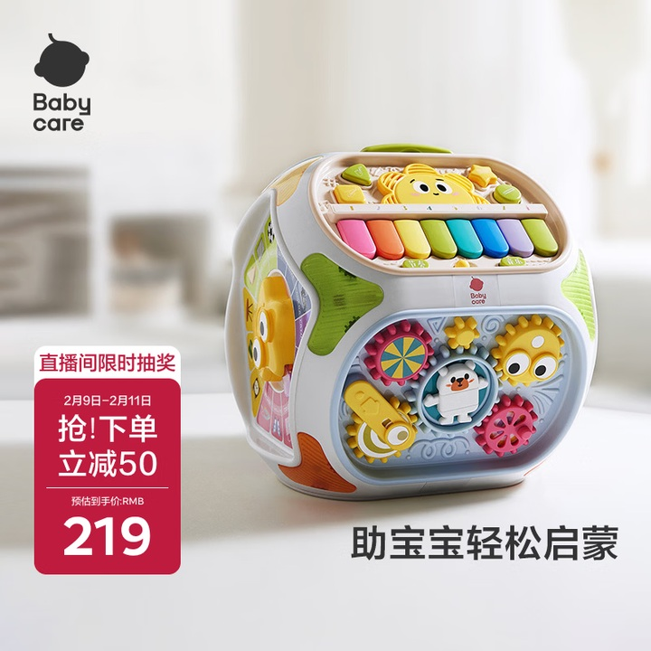
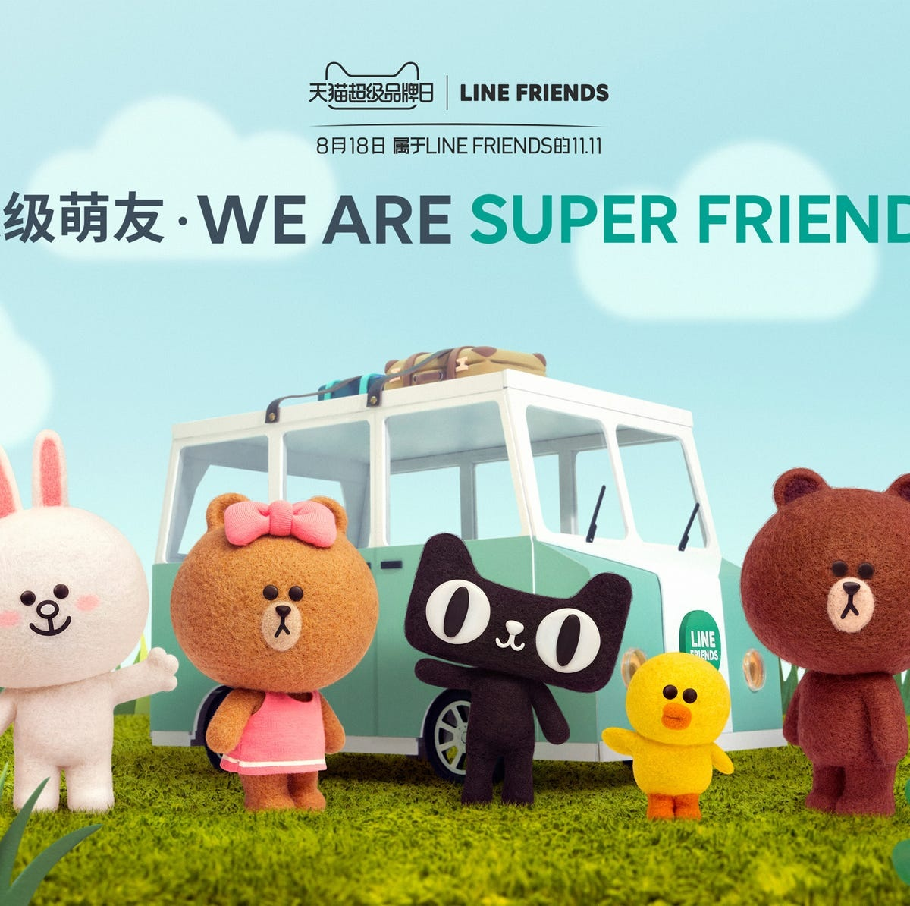
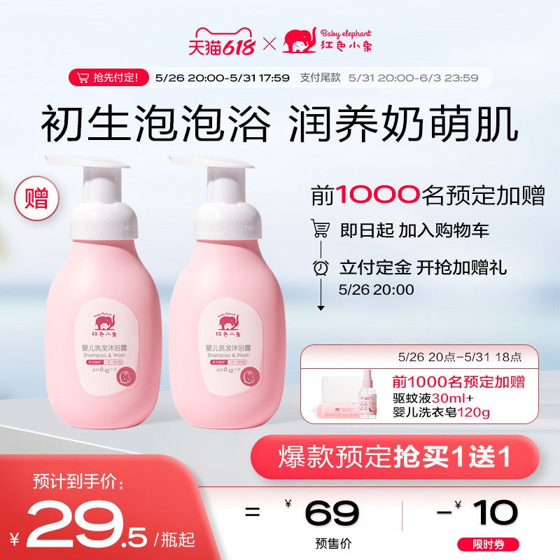

# 1_商品首图 · 母婴玩具 代表图

本组按商品呈现、信息组织和动线选取不同结构。占比为目测描述，不是排版指令。

## 1-059：互动玩具

用途：活动促销；参考角色：整图布局参考；标签：中心英雄;场景叙事

可借鉴：完整玩具以三分之四角度露出多面结构，文字放在留白处

不适合照搬：玩具功能和年龄适用性不能从视觉猜测

## 1-060：角色毛绒玩具

用途：品牌形象；参考角色：整图布局参考；标签：多商品组合;场景叙事

可借鉴：角色沿前景等高排列，车辆靠后，上方主题横跨形成叙事层次

不适合照搬：IP角色、车辆模型和联名不能继承到普通玩具

## 1-062：婴儿洗护

用途：活动促销；参考角色：整图布局参考；标签：左右分栏;多商品组合;底部信息带

可借鉴：左双瓶与右侧加赠步骤分区，下方独立算式不挡瓶身

不适合照搬：婴幼儿适用范围、赠品和润养功效需产品证据
