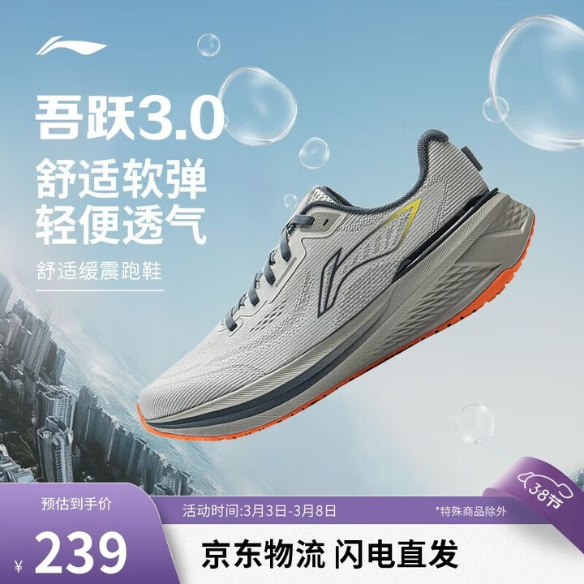
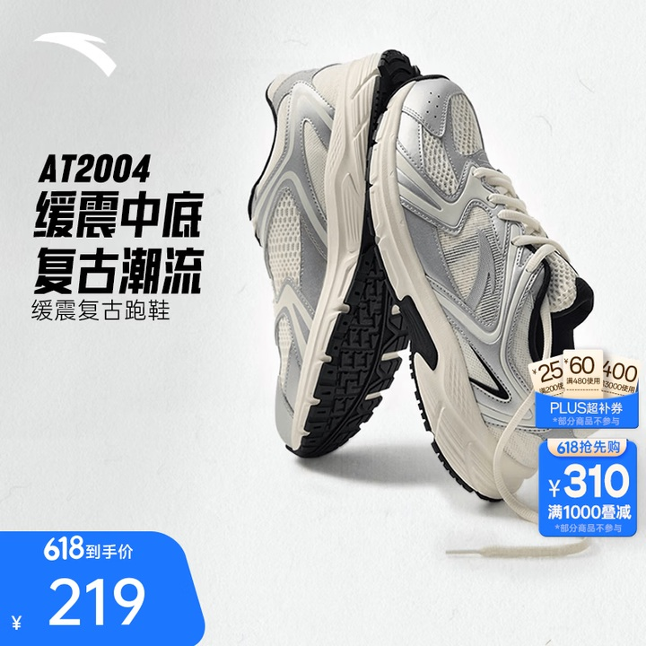
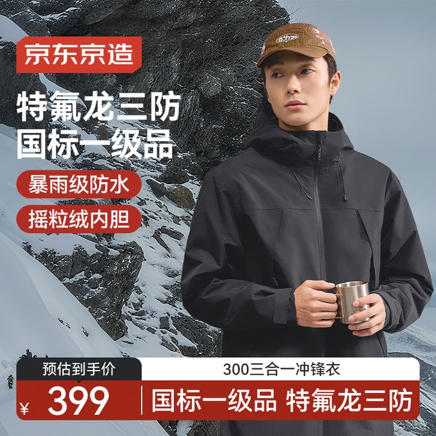

# 1_商品首图 · 运动户外 代表图

本组按商品呈现、信息组织和动线选取不同结构。占比为目测描述，不是排版指令。

## 1-074：跑鞋

用途：活动促销；参考角色：整图布局参考；标签：非对称构图;中心英雄

可借鉴：斜向整鞋与左上短标题形成动线，鞋面和鞋底边缘保留

不适合照搬：悬置与气泡不能解释真实缓震结构；不能移植功能宣称

## 1-076：跑鞋

用途：活动促销；参考角色：整图布局参考；标签：多角度并置;左右分栏

可借鉴：一只展示鞋面、一只展示鞋底，左侧短标题不挡纹路

不适合照搬：两只不同角度不能被误读为两套出售，纹路需真实素材

## 1-077：冲锋衣

用途：活动促销；参考角色：整图布局参考；标签：人物互动;场景叙事;左右分栏

可借鉴：右侧穿着图与左侧功能短句对照，底栏不切衣服主要结构

不适合照搬：天气画面不证明防水等级，人物和参数须重新获取
