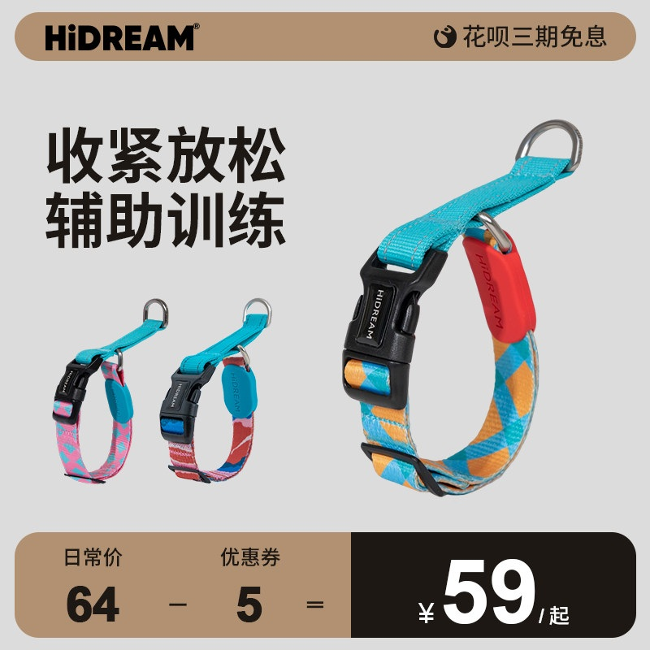
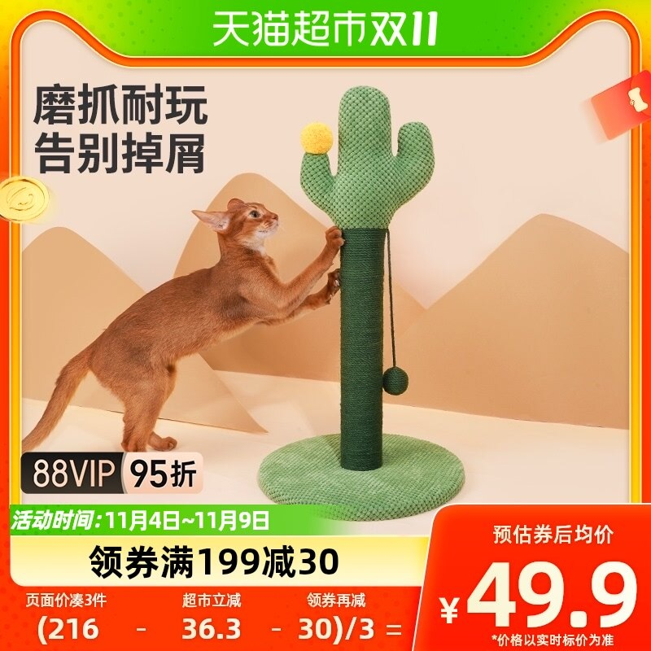
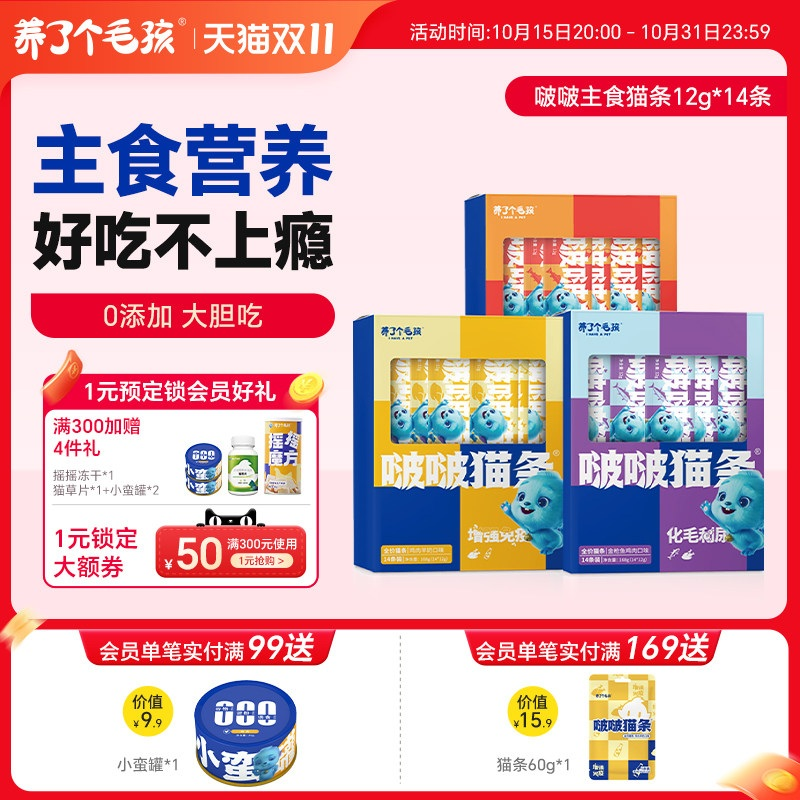

# 1_商品首图 · 宠物用品 代表图

本组按商品呈现、信息组织和动线选取不同结构。占比为目测描述，不是排版指令。

## 1-018：宠物项圈

用途：活动促销；参考角色：整图布局参考；标签：局部特写;多角度并置;非对称构图

可借鉴：右侧大项圈露出扣具和环扣，左下小款图提供完整比例

不适合照搬：不同颜色不一定是套装；训练作用需新商品资料

## 1-019：猫抓柱

用途：活动促销；参考角色：使用关系参考；标签：人物互动;场景叙事

可借鉴：用猫的接触动作展示抓柱用途，保留立柱完整高度与底座

不适合照搬：猫体型不能代替商品尺寸；耐磨与不掉屑需要真实依据

## 1-021：猫条组合

用途：活动促销；参考角色：整图布局参考；标签：左右分栏;多商品组合;参数卡片列

可借鉴：左侧短卖点与右侧包装分工，会员赠品压成底部独立两格

不适合照搬：赠品与主商品必须分开；营养与口味不应从参考复制
