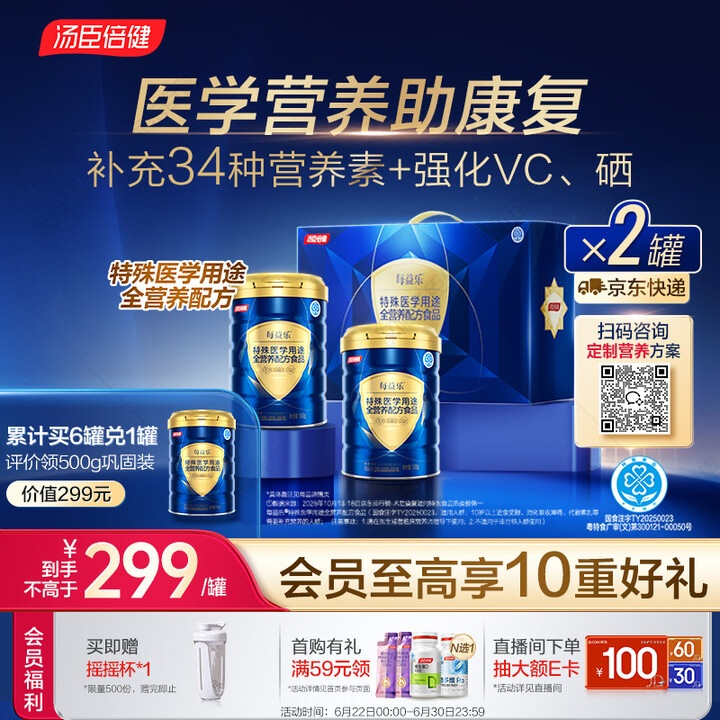
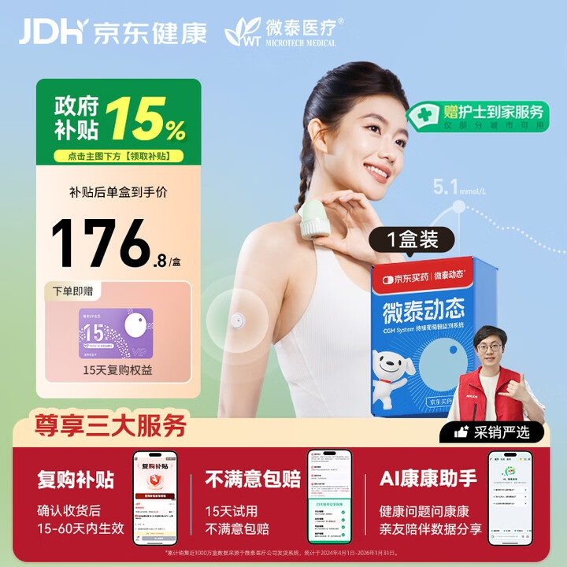
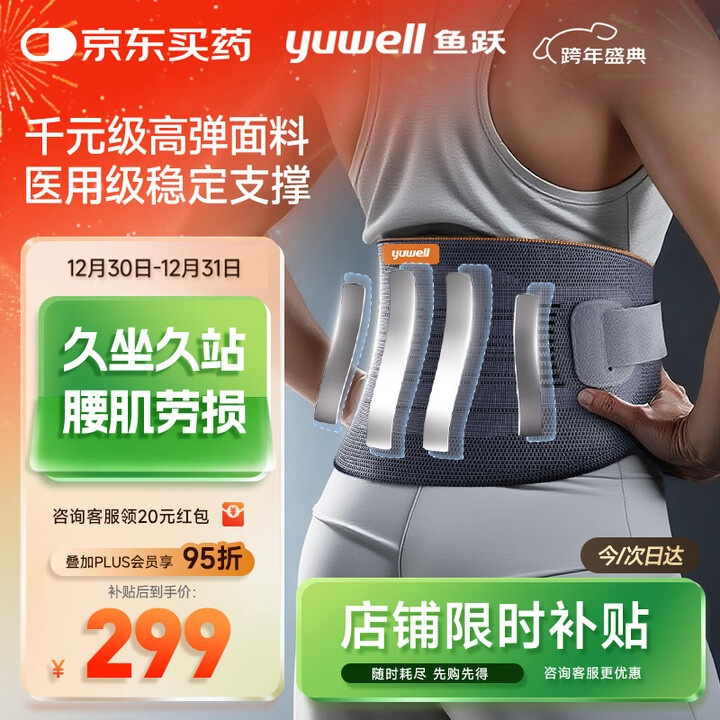
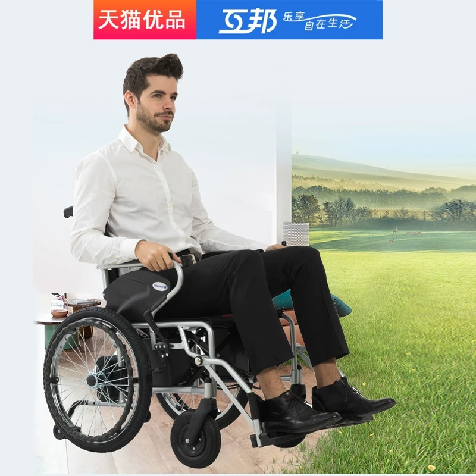
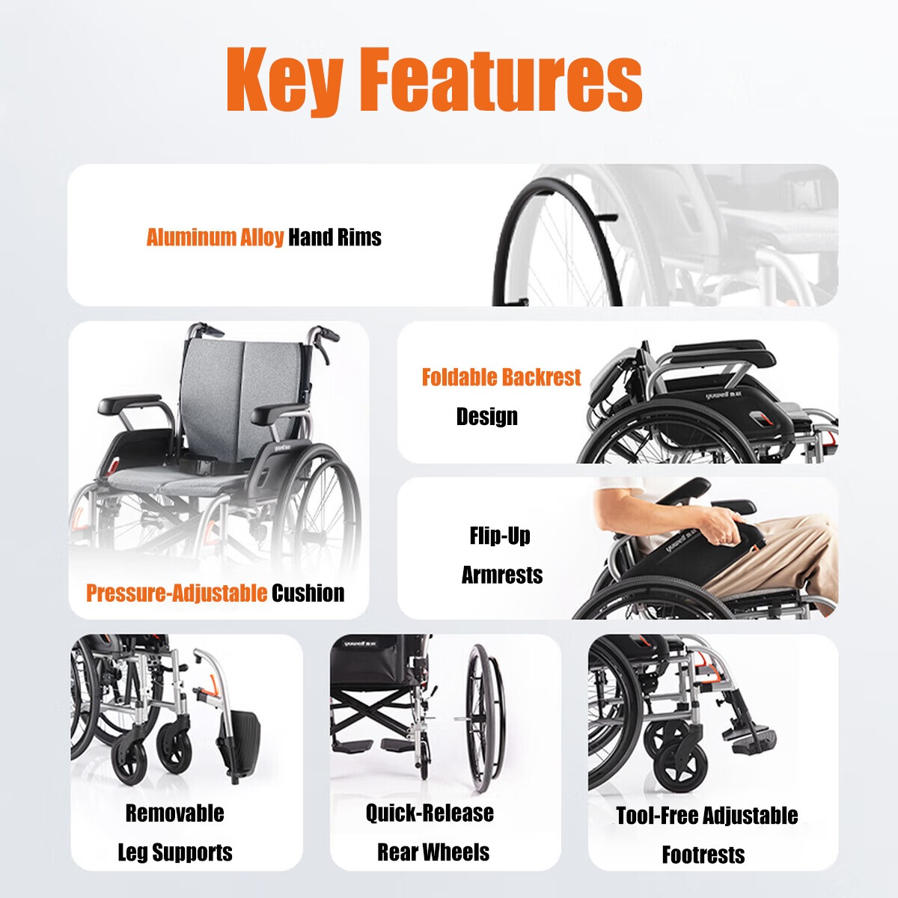

# 1_商品首图 · 医疗健康 代表图

本组按商品呈现、信息组织和动线选取不同结构。占比为目测描述，不是排版指令。

## 1-001：营养品／特殊医学用途食品

用途：活动促销；参考角色：整图布局参考；标签：字体主导;多商品组合;底部信息带

可借鉴：上半部集中传播主张，中部组合包装，底部会员权益单独成行

不适合照搬：医学用途与康复表述不能迁移；图中文字不证明新产品资质

## 1-002：小型监测器械／血糖监测

用途：活动促销；参考角色：使用关系参考；标签：人物互动;左右分栏;参数卡片列

可借鉴：手臂佩戴小器械与包装小图并置，底部服务分三栏解释

不适合照搬：人物不能作为疗效证明；不适合展示轮椅等大件结构

## 1-005：护理用品／腰部支撑带

用途：活动促销；参考角色：使用关系参考；标签：局部特写;人物互动;左右分栏

可借鉴：用人物局部放大支撑带，左栏从材质到使用对象再到价格

不适合照搬：不能沿用疼痛改善主张；裁切人物不能证明全套佩戴流程

## 1-补构图014：大件行动辅助用品／电动轮椅乘坐

用途：单品展示；参考角色：使用关系参考；标签：人物互动;场景叙事;非对称构图

可借鉴：保持完整车架、脚踏和手控可见，乘坐姿态解释人与商品的比例

不适合照搬：不可由画面推断地形通过性、续航，脚踏接触和后景尺度需重新核对

## 1-补构图029：大件行动辅助用品／手动轮椅部件

用途：单品展示；参考角色：局部机制参考；标签：局部特写;卡片矩阵;结构展示

可借鉴：大部件图优先讲坐垫和扶手，底部小卡解释脚踏和轮子，按动作分区

不适合照搬：本图缺完整车架，创作须补识别锚点；快拆、翻转等结构必须真实
