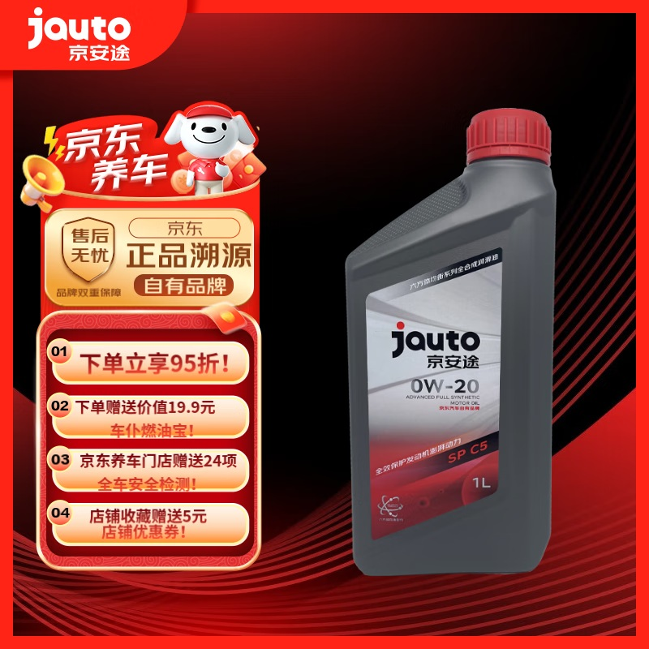
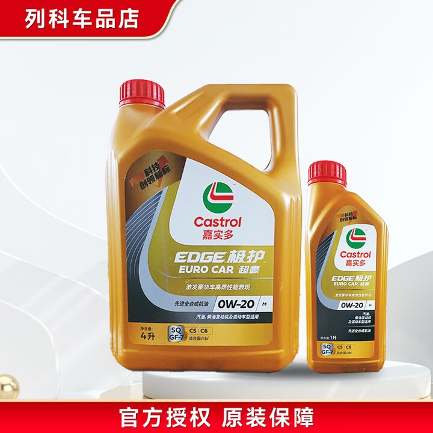
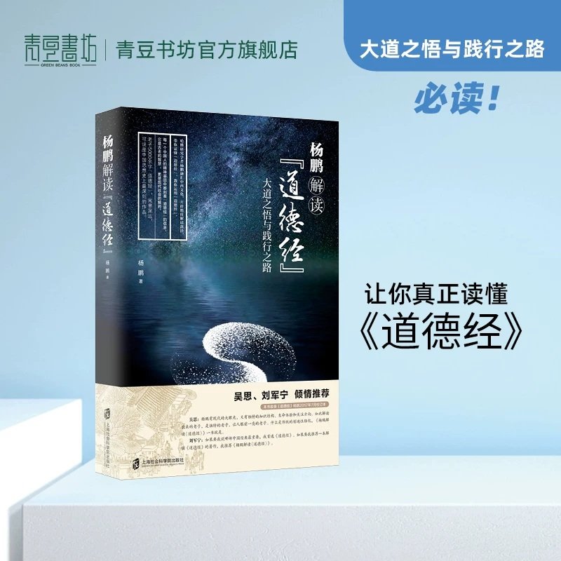

# 1_商品首图 · 汽车用品与图书文创 代表图

本组按商品呈现、信息组织和动线选取不同结构。占比为目测描述，不是排版指令。

## 1-补018：汽车养护／机油

用途：活动促销；参考角色：整图布局参考；标签：左右分栏;中心英雄

可借鉴：右侧完整瓶身与左侧编号权益列分开，产品标签保持可辨

不适合照搬：黏度、等级、适配范围及赠品必须重新核实

## 1-补021：汽车养护／机油

用途：单品展示；参考角色：整图布局参考；标签：中心英雄;多商品组合;留白构图

可借鉴：主瓶与小瓶并排且高度有差，让规格组合第一眼可见

不适合照搬：两瓶组合不等于新商品套装；授权文字不能直接继承

## 1-补构图090：实体图书／哲学阅读

用途：单品展示；参考角色：整图布局参考；标签：左右分栏;中心英雄;舞台陈列

可借鉴：立体书放在一侧，推荐语另一侧，顶部小标题不压封面

不适合照搬：作者、书名、版本、推荐语不能用于其他书
