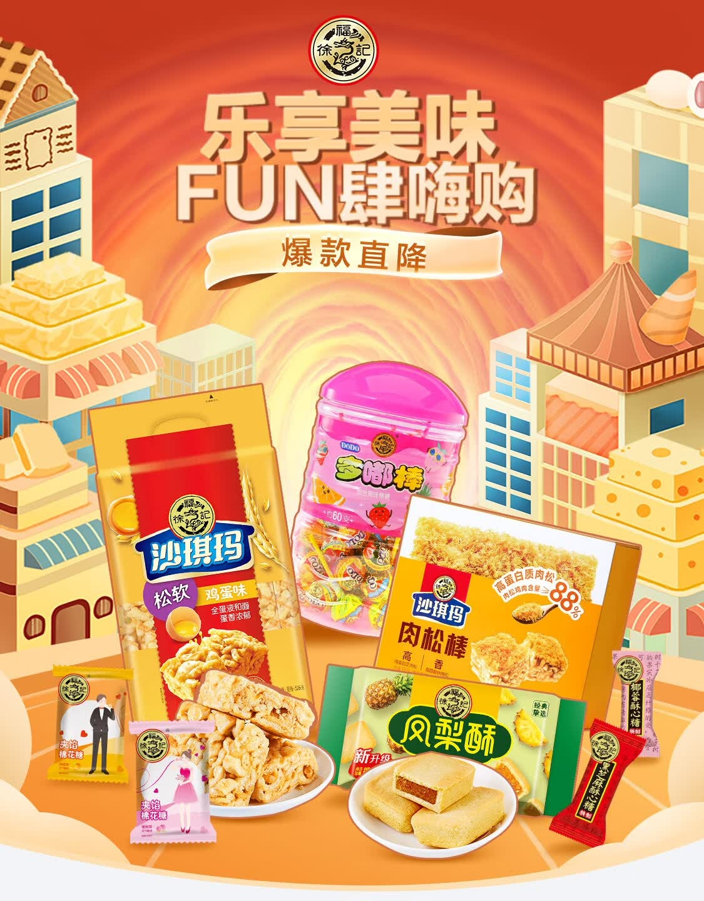
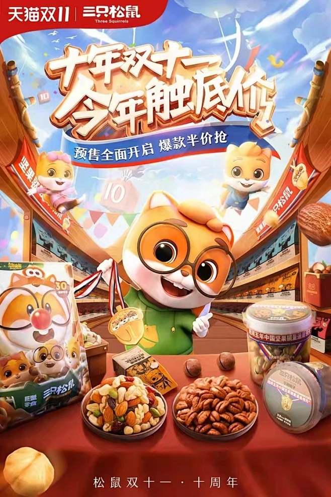
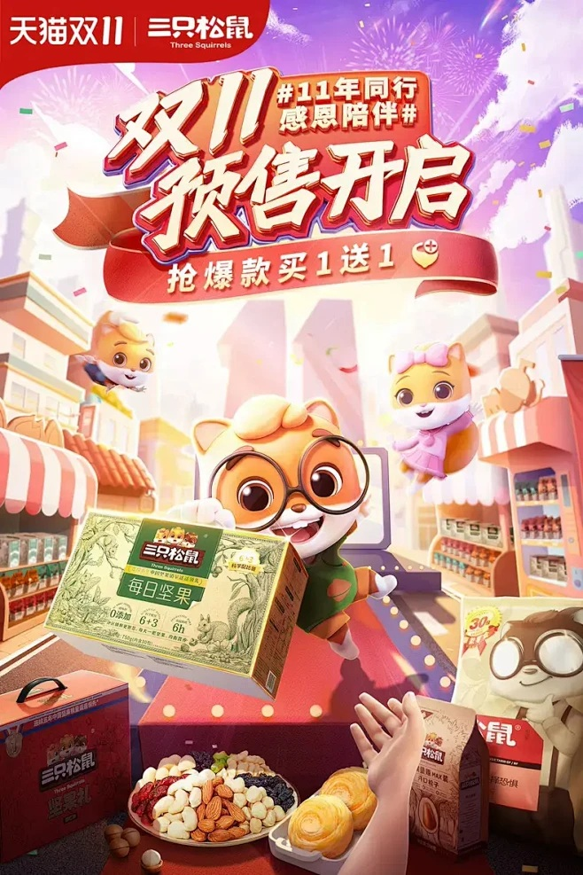

# 2_商品专题海报 · 食品零食 代表图

本组按商品呈现、信息组织和动线选取不同结构。占比为目测描述，不是排版指令。

## 2-094：包装零食组合

用途：活动促销；参考角色：整图布局参考；标签：多商品组合;场景叙事;上下分区

可借鉴：高低包装围绕食品实物，顶部集中主题，背景建筑不抢品牌

不适合照搬：食品种类与包装不能当成新套装；城市意象不适合所有食品

## 2-095：坚果零食组合

用途：活动促销；参考角色：整图布局参考；标签：人物互动;场景叙事;前后景分层

可借鉴：透视街道把视线导向中央角色，前景食品完成品类识别

不适合照搬：IP与周年不能继承；商品量多不适合强调单件口味

## 2-096：坚果礼盒

用途：活动促销；参考角色：整图布局参考；标签：人物互动;场景叙事;非对称构图

可借鉴：大礼盒朝向右下接收的手，前景碗装坚果提供食用锚点

不适合照搬：不能原样复用IP、手势素材或买赠机制
