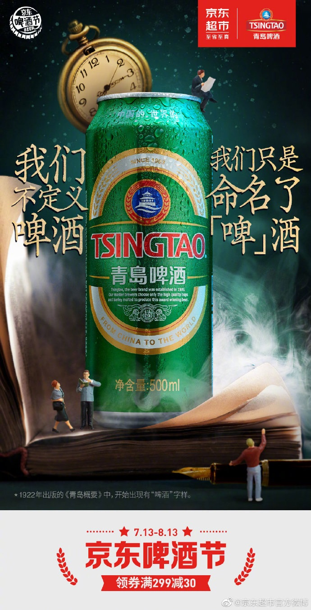
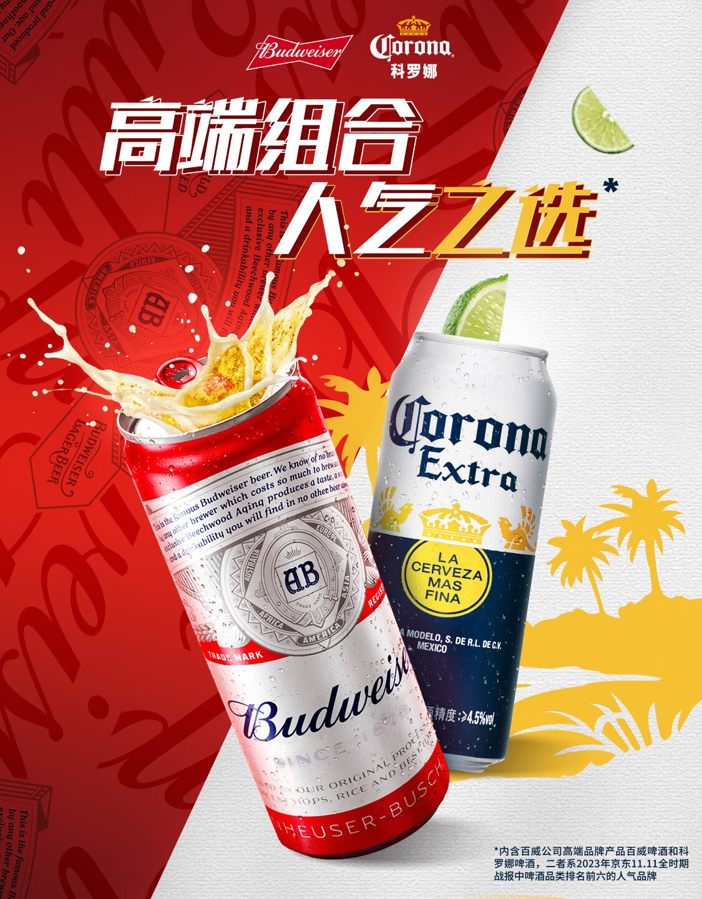
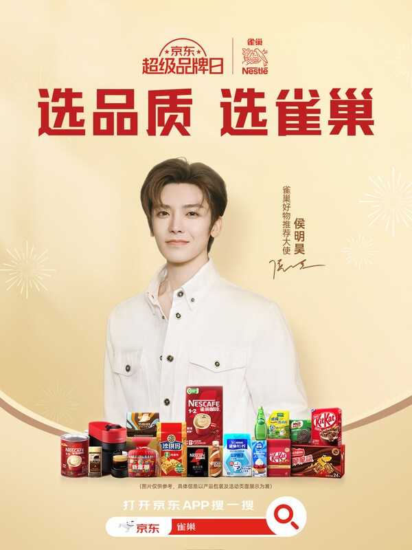

# 2_商品专题海报 · 酒水饮料 代表图

本组按商品呈现、信息组织和动线选取不同结构。占比为目测描述，不是排版指令。

## 2-087：罐装啤酒

用途：品牌形象；参考角色：整图布局参考；标签：中心英雄;场景叙事;非对称构图

可借鉴：左右短句围绕中央大罐，书本与时钟构成口碑叙事而非参数栏

不适合照搬：超现实比例不是实物尺度，不能用来说明容量

## 2-089：双品牌啤酒组合

用途：活动促销；参考角色：整图布局参考；标签：非对称构图;多商品组合;前后景分层

可借鉴：红白对角分区对应两罐，前后大小差形成阅读顺序

不适合照搬：酒液与成分效果需匹配实际口味；联名不代表可混用品牌资产

## 2-090：咖啡食品混合

用途：品牌形象；参考角色：整图布局参考；标签：人物互动;上下分区;多商品组合

可借鉴：人物居中建立形象，底部等高商品列保持品类锚点

不适合照搬：不适合作为某一罐咖啡的结构展示或功效证据
