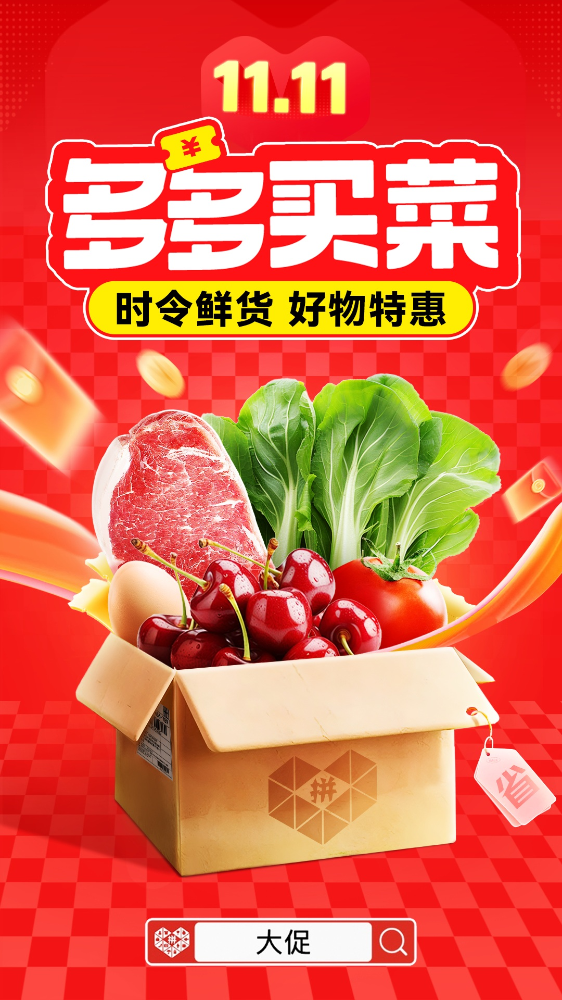
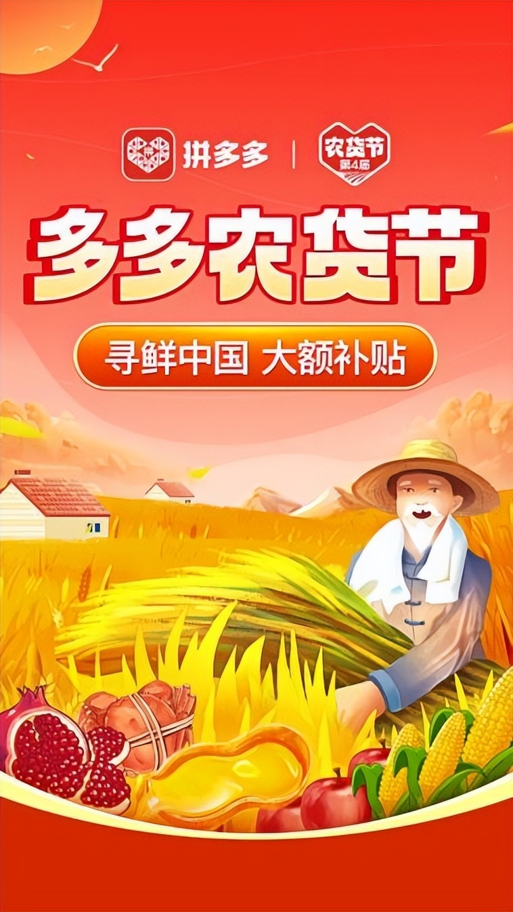

# 2_商品专题海报 · 生鲜农产品 代表图

本组按商品呈现、信息组织和动线选取不同结构。占比为目测描述，不是排版指令。

## 2-098：生鲜果蔬混合

用途：活动促销；参考角色：整图布局参考；标签：中心英雄;上下分区

可借鉴：将商品篮放上半部而大主题置下半部，改变常见上字下物顺序

不适合照搬：券活动和综合篮不能变成单一水果的售价与装箱规格

## 2-099：肉菜水果混合

用途：店铺综合图；参考角色：整图布局参考；标签：字体主导;中心英雄;多商品组合

可借鉴：顶部大字与中央开箱形成两段阅读，包装箱把多品类收束成整体

不适合照搬：不能把混合箱当成实际出售的固定组合

## 2-100：农产品综合

用途：品牌形象；参考角色：整图布局参考；标签：场景叙事;人物互动;字体主导

可借鉴：上部主题清楚，下半部人物动作与田野连接传播内容

不适合照搬：插画人物与产地不可直接复用；不是具体农产品品质证据
