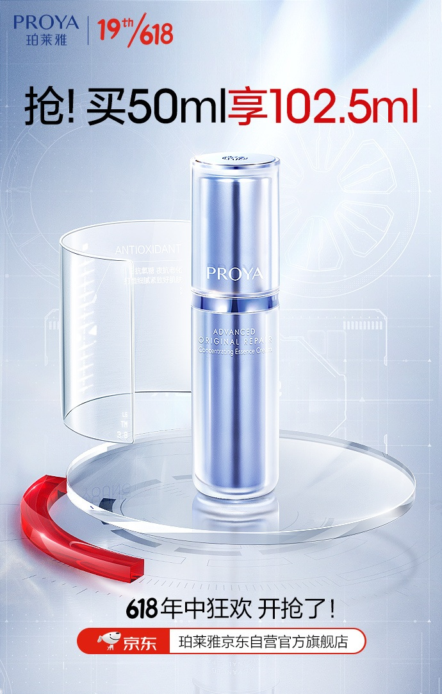
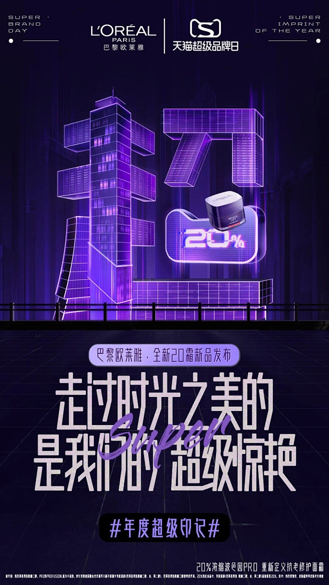
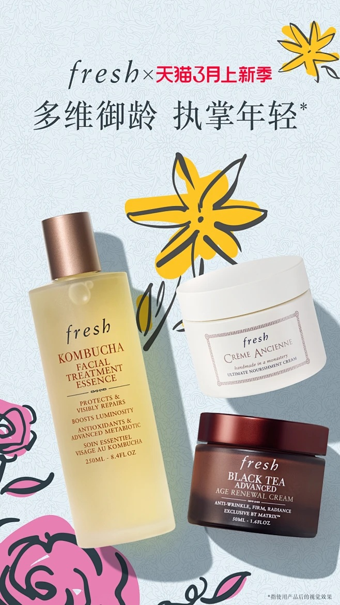

# 2_商品专题海报 · 美妆护肤 代表图

本组按商品呈现、信息组织和动线选取不同结构。占比为目测描述，不是排版指令。

## 2-063：精华单品

用途：活动促销；参考角色：整图布局参考；标签：中心英雄;留白构图

可借鉴：单瓶在中央，透明环围而不遮挡，标题与底部入口各留空

不适合照搬：包装规格与赠送容量需重新核实；不能仅换色重复选同类图

## 2-067：护肤品牌活动

用途：品牌形象；参考角色：整图布局参考；标签：字体主导;场景叙事

可借鉴：上部数字建筑与下部文字形成双重主题，产品小图作为识别锚点

不适合照搬：不适合承担普通护肤单品首图或实际成分展示

## 2-068：护肤套装

用途：品牌形象；参考角色：整图布局参考；标签：俯视陈列;非对称构图;多商品组合

可借鉴：不同高度瓶罐错位排开，花朵只占空隙，不另加参数卡

不适合照搬：手绘花卉不等于真实成分；套装件数和配方不可继承
