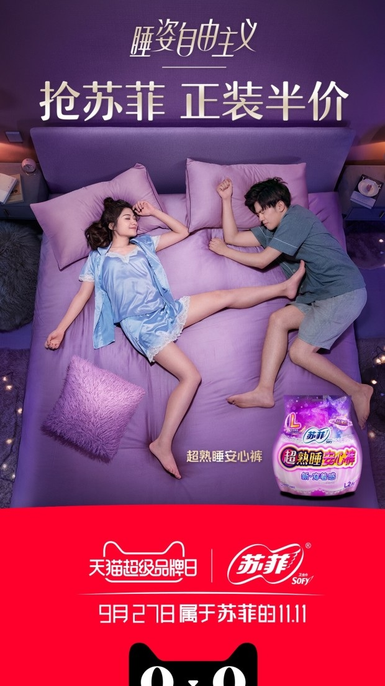
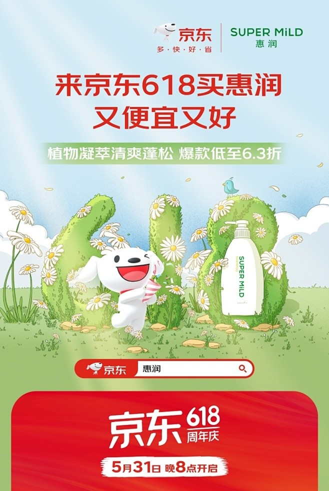
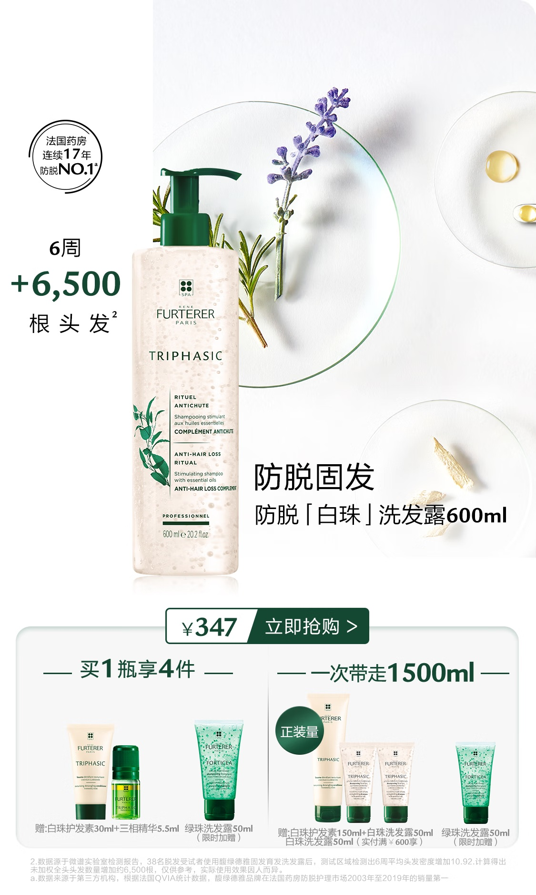

# 2_商品专题海报 · 个护清洁 代表图

本组按商品呈现、信息组织和动线选取不同结构。占比为目测描述，不是排版指令。

## 2-032：卫生护理用品

用途：活动促销；参考角色：整图布局参考；标签：人物互动;场景叙事;上下分区

可借鉴：大生活场景承担使用情绪，产品小图在场景角落，底部品牌另分区

不适合照搬：人物情境不证明产品效果；小包装不足以展示规格结构

## 2-065：洗发水

用途：活动促销；参考角色：整图布局参考；标签：字体主导;场景叙事;中心英雄

可借鉴：主标题与中部数字景观分段，单瓶藏在数字内作商品锚点

不适合照搬：植物意象不能证明成分；不能替代清楚的单瓶结构图

## 2-补构图043：洗发护理单品与赠品

用途：活动促销；参考角色：整图布局参考；标签：非对称构图;卡片矩阵;完整与细节并置

可借鉴：上段先用完整主瓶建立识别，下段把不同赠品分卡说明，避免混同购买对象

不适合照搬：功效和防脱证据不能继承，赠品需要重新确认；细字缩小后易读不清
