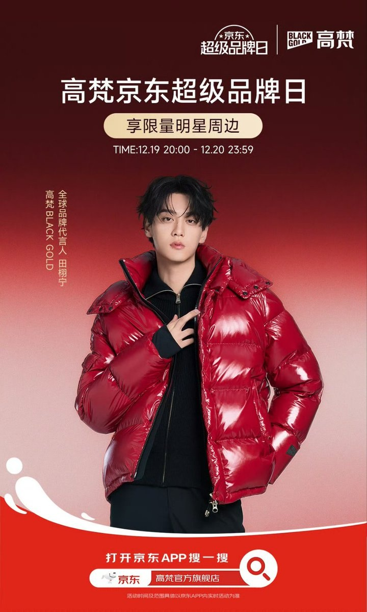
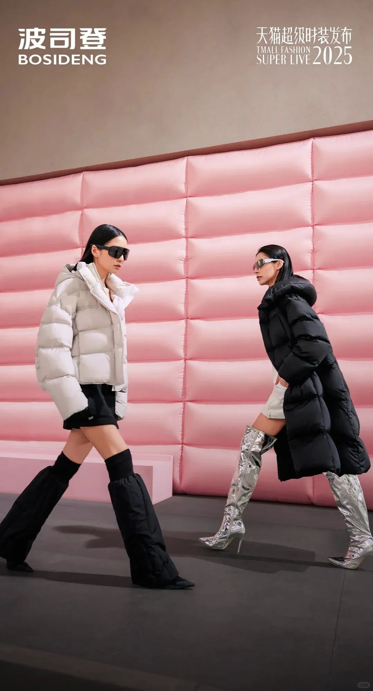
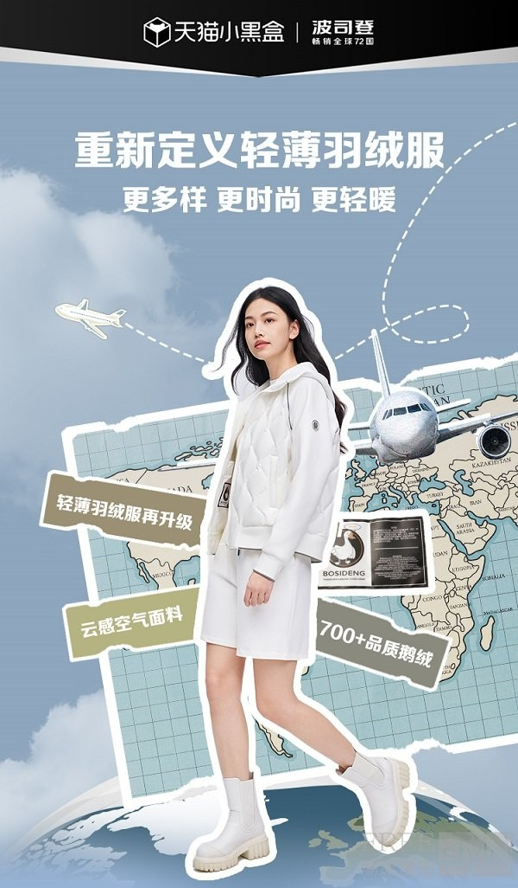

# 2_商品专题海报 · 服饰内衣 代表图

本组按商品呈现、信息组织和动线选取不同结构。占比为目测描述，不是排版指令。

## 2-054：短款羽绒服

用途：品牌形象；参考角色：整图布局参考；标签：人物互动;上下分区

可借鉴：人物完整上身与上部活动文字分开，底部仅放入口

不适合照搬：人物和羽绒服材质不可复用；品牌图不证明保暖参数

## 2-056：长短羽绒服

用途：品牌形象；参考角色：整图布局参考；标签：人物互动;场景叙事;非对称构图

可借鉴：两种衣长通过相对行走姿态对照，品牌缩小退到顶部

不适合照搬：不能把人物高矮当作衣长尺寸；走秀背景并非保暖证据

## 2-058：轻薄羽绒服

用途：品牌形象；参考角色：整图布局参考；标签：人物互动;场景叙事;参数卡片列

可借鉴：人物轮廓作为中轴，左右功能卡与地图背景解释出行定位

不适合照搬：地图与参数属于概念演绎，不能沿用未经证实的填充数据
