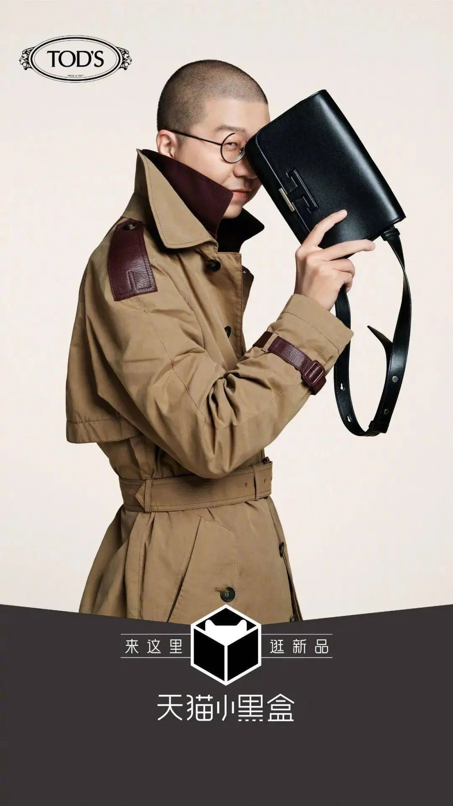
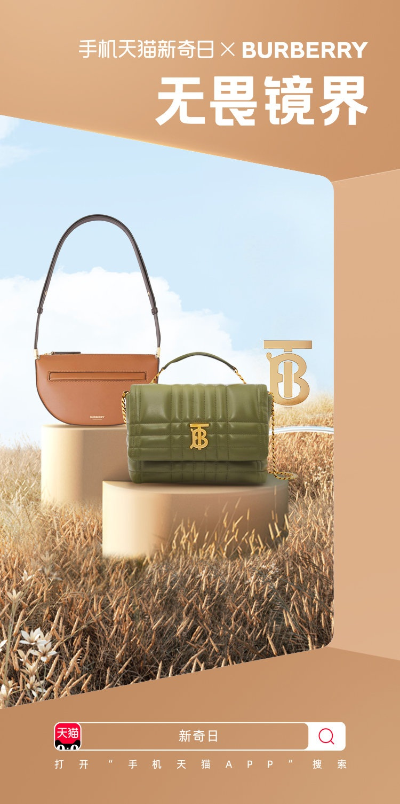
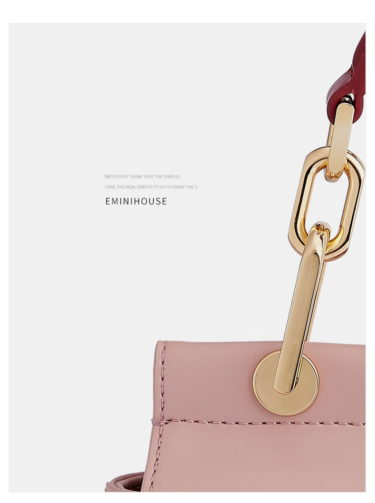

# 2_商品专题海报 · 鞋靴箱包 代表图

本组按商品呈现、信息组织和动线选取不同结构。占比为目测描述，不是排版指令。

## 2-057：皮包

用途：品牌形象；参考角色：整图布局参考；标签：人物互动;局部特写;上下分区

可借鉴：手持包靠近脸部成为焦点，底部平台区与人物分开

不适合照搬：包结构显示有限，不适合说明容量、夹层或全套配置

## 2-补构图067：女包系列

用途：品牌形象；参考角色：整图布局参考；标签：框中框;场景叙事;多商品组合

可借鉴：用建筑框把商品与后景分出深度，两个不同包型沿台座错开

不适合照搬：虚拟时装主题不代表真实材质和尺寸，联名授权不可沿用

## 2-补构图235：女包链带与连接五金

用途：单品展示；参考角色：局部机制参考；标签：局部特写;非对称构图

可借鉴：右侧局部裁切露出链带、孔眼、缝线，左侧只留一个短主题

不适合照搬：这是外部转载的细节图，原投放版位未知；缺完整包型，应配本商品完整识别图
