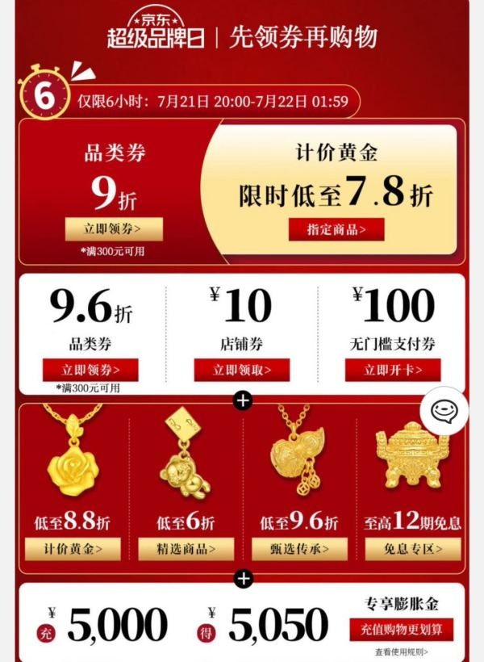
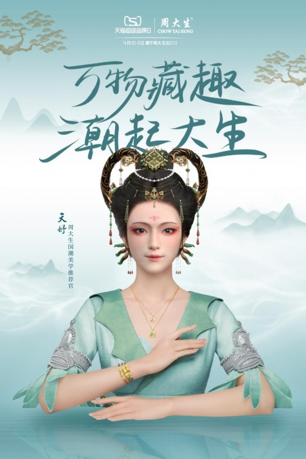
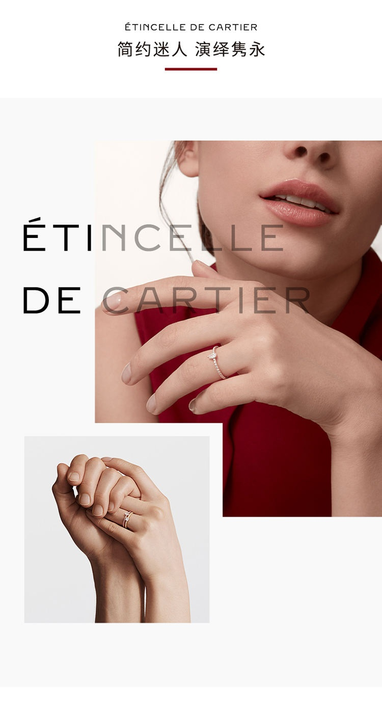

# 2_商品专题海报 · 珠宝钟表 代表图

本组按商品呈现、信息组织和动线选取不同结构。占比为目测描述，不是排版指令。

## 2-补024：黄金首饰综合

用途：活动促销；参考角色：整图布局参考；标签：字体主导;参数卡片列;多商品组合

可借鉴：券区用不同层级的整行和多列网格，首饰行只承担品类识别

不适合照搬：这是活动导航图，不可当作普通项链的规格或售价图

## 2-补030：黄金珠宝佩戴

用途：品牌形象；参考角色：整图布局参考；标签：人物互动;场景叙事;字体主导

可借鉴：大字在人物上方，手臂姿态露出腕部首饰，背景山水不占信息栏

不适合照搬：国风形象与数字人物不可借用；细小饰品不适合工艺判断

## 2-补构图215：戒指佩戴与手部细节

用途：品牌形象；参考角色：整图布局参考；标签：局部特写;完整与细节并置;非对称构图

可借鉴：大人物裁切负责情绪，小手部图作为佩戴识别锚点，上下留白减少文字干扰

不适合照搬：肖像、品牌、戒指结构和材质不可继承；小图不等于赠品
