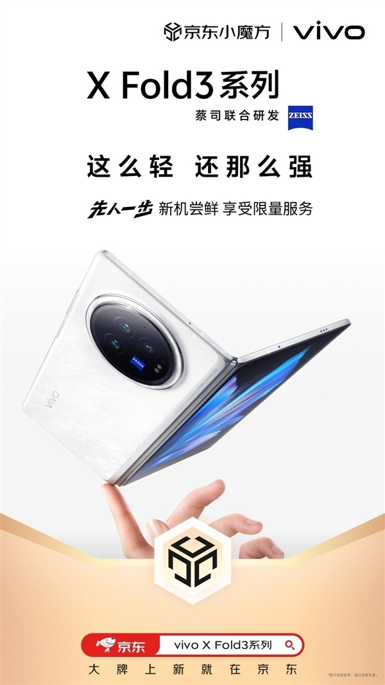
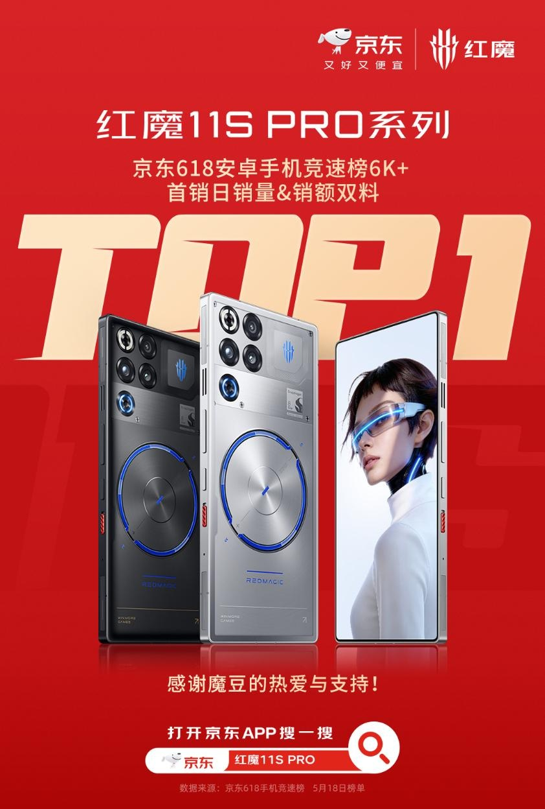

# 2_商品专题海报 · 手机数码 代表图

本组按商品呈现、信息组织和动线选取不同结构。占比为目测描述，不是排版指令。

## 2-035：折叠手机

用途：品牌形象；参考角色：整图布局参考；标签：非对称构图;人物互动;留白构图

可借鉴：展开手机沿斜线占中心，手指建立尺度暗示，上下保留留白

不适合照搬：托举意象不等于实际重量证据；铰链与开合角度需真实资料

## 2-036：游戏手机

用途：品牌形象；参考角色：整图布局参考；标签：字体主导;多角度并置

可借鉴：大排名字位于手机后方，手机正背面压在字前形成层次

不适合照搬：排名和人物屏幕不能继承；战报并非性能测评

## 2-038：手机影像

用途：品牌形象；参考角色：整图布局参考；标签：人物互动;场景叙事

可借鉴：把手机放在自拍动作起点，人物与枝叶引出社交场景

不适合照搬：插画不展示真实工业结构；像素数与人物资产不可沿用
