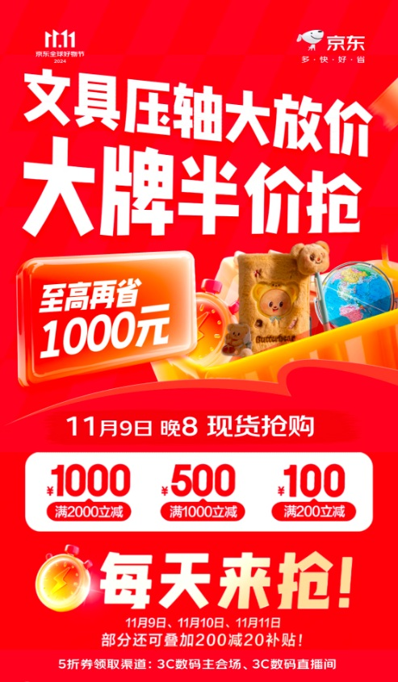
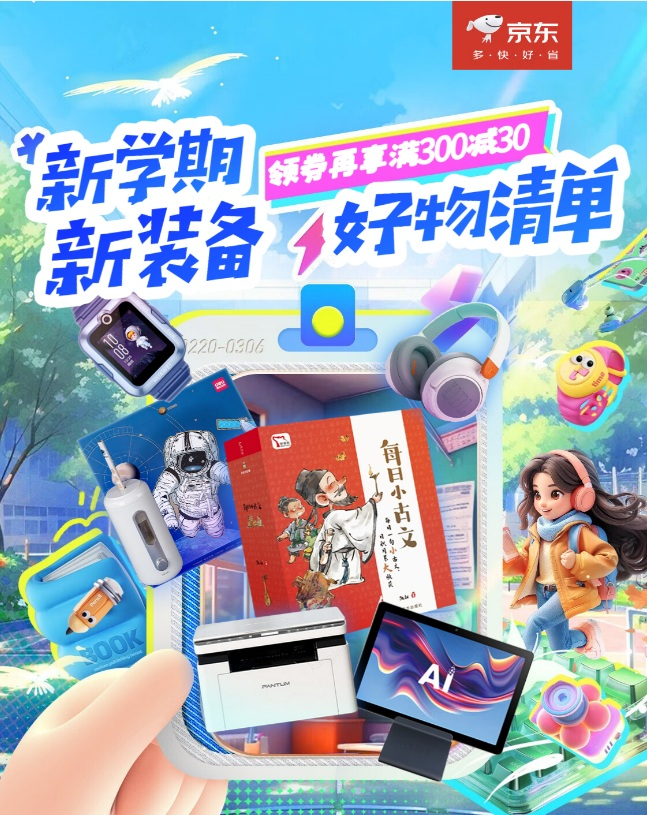
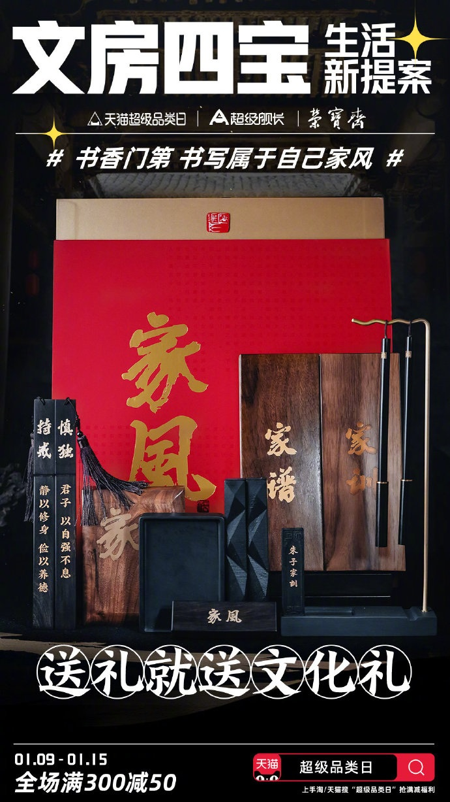

# 2_商品专题海报 · 电脑办公 代表图

本组按商品呈现、信息组织和动线选取不同结构。占比为目测描述，不是排版指令。

## 2-048：文具综合

用途：活动促销；参考角色：整图布局参考；标签：字体主导;上下分区;参数卡片列

可借鉴：主题大字、三栏券卡与下部日期分成三层，商品退为品类提示

不适合照搬：不能用活动券代替商品售价或性能信息

## 2-050：学习办公设备混合

用途：店铺综合图；参考角色：整图布局参考；标签：多商品组合;人物互动;场景叙事

可借鉴：商品群汇入购物篮，儿童与手部在边缘提供开学情境

不适合照搬：清单图不代表某个设备配齐所有附件

## 2-051：书法文具礼盒

用途：品牌形象；参考角色：整图布局参考；标签：字体主导;中心英雄;上下分区

可借鉴：完整礼盒居中，标题在顶，礼赠主题在商品下方，形成纵向读序

不适合照搬：“文化礼”不证明材料等级；书法、包装和品牌资产不沿用
