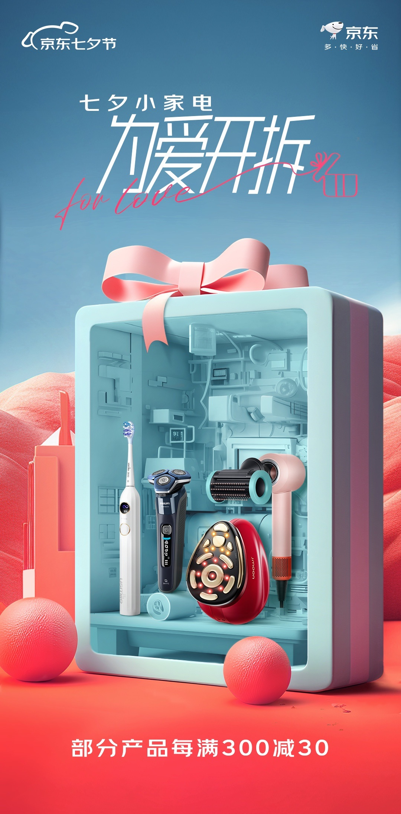
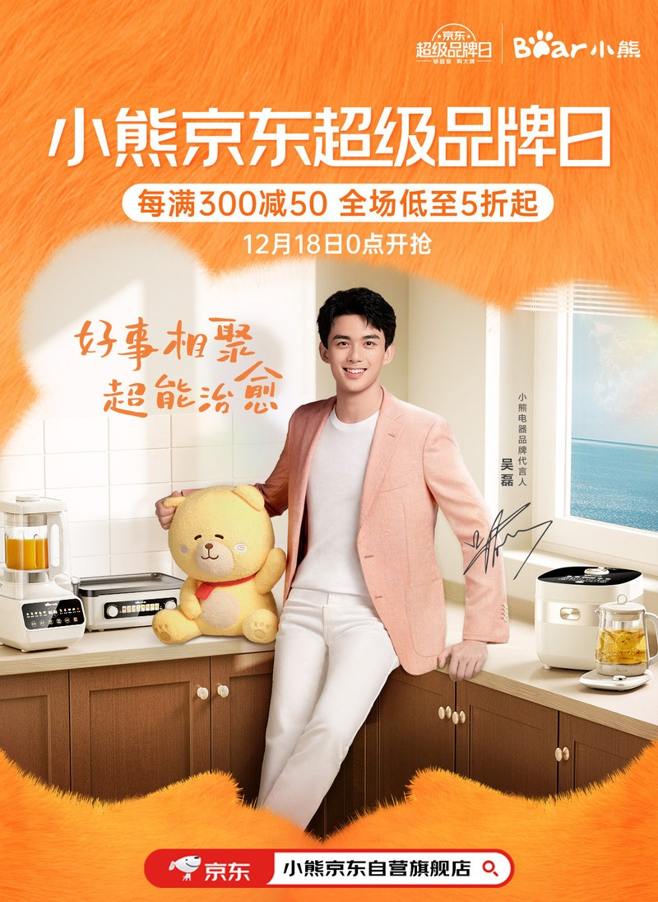
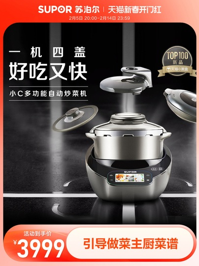

# 2_商品专题海报 · 家用电器 代表图

本组按商品呈现、信息组织和动线选取不同结构。占比为目测描述，不是排版指令。

## 2-017：个护小电器组合

用途：活动促销；参考角色：整图布局参考；标签：多商品组合;中心英雄;场景叙事

可借鉴：把多件小电器放进同一立体展示盒，顶部与底部信息克制

不适合照搬：礼盒展示不代表售卖套装；不能自动添加配件

## 2-019：厨房小家电

用途：品牌形象；参考角色：整图布局参考；标签：人物互动;场景叙事

可借鉴：人物与厨房台面形成生活关系，家电沿操作台展示而非悬浮

不适合照搬：人物与赠送玩偶不一定是商品组成；功能不可从场景推断

## 2-020：多功能炒菜机

用途：活动促销；参考角色：整图布局参考；标签：完整与细节并置;中心英雄;非对称构图

可借鉴：完整锅体与不同锅盖并置，标题在左上，底栏承担交易信息

不适合照搬：拆分盖子的数量与功能需真实资料，不能模拟不存在的配件
