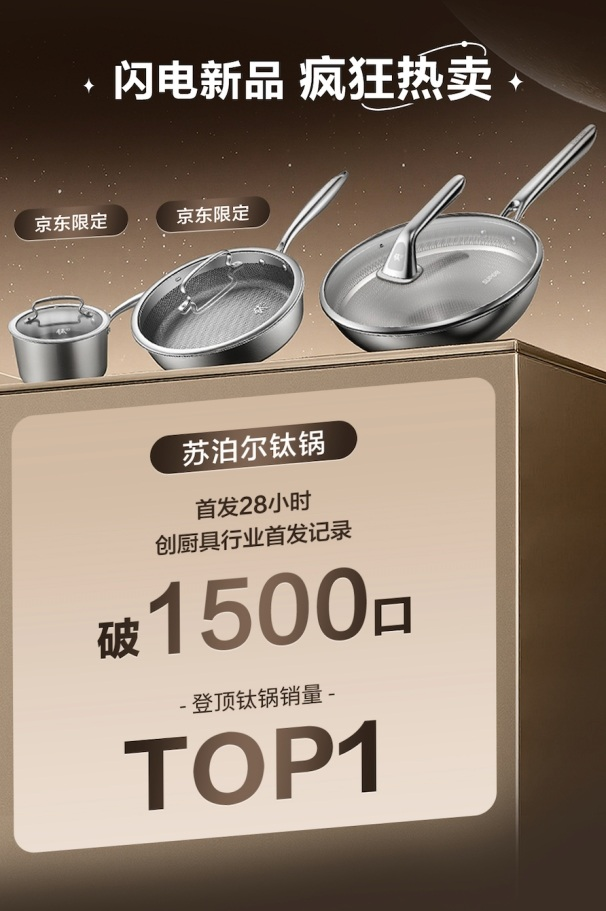
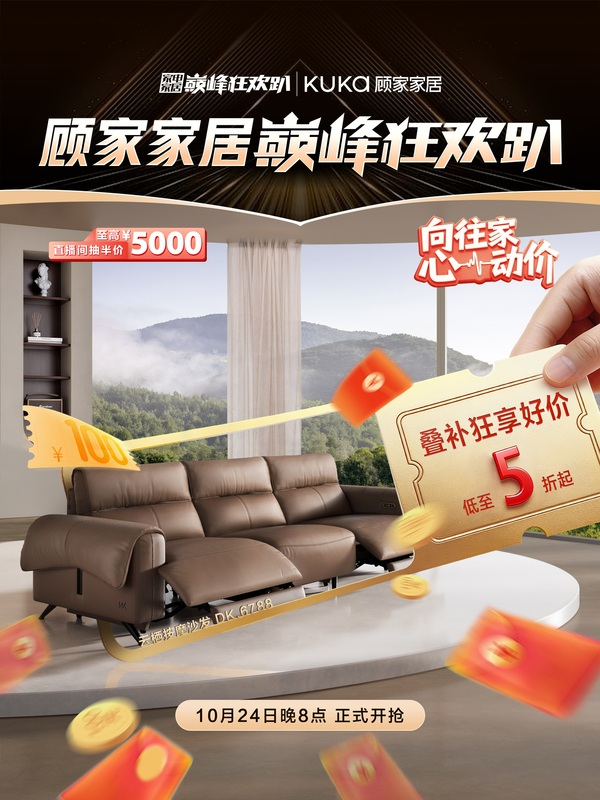
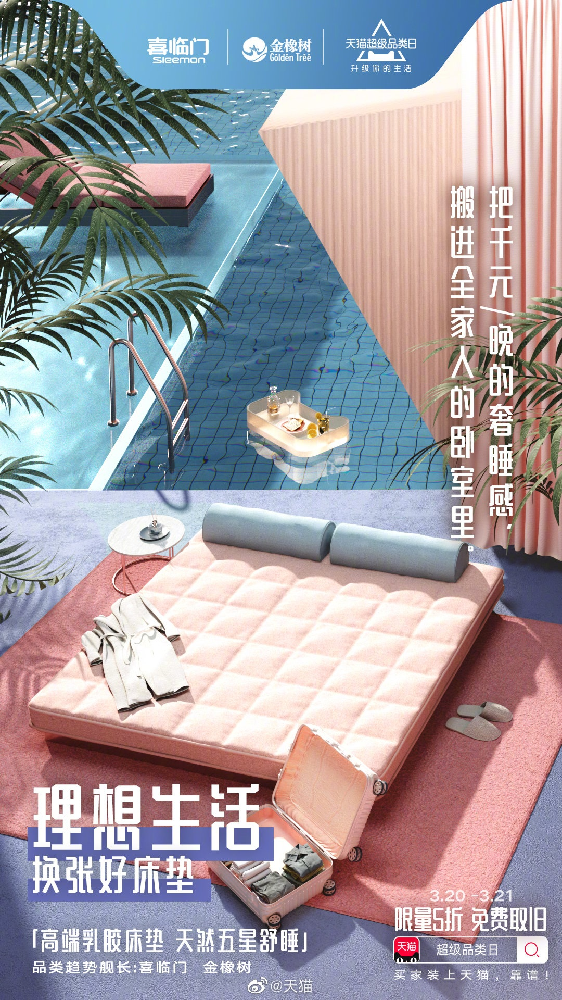

# 2_商品专题海报 · 家居家具 代表图

本组按商品呈现、信息组织和动线选取不同结构。占比为目测描述，不是排版指令。

## 2-014：金属锅具组合

用途：品牌形象；参考角色：整图布局参考；标签：字体主导;多商品组合;上下分区

可借鉴：商品缩到上排，战报卡占下半，将品牌结果设为传播重点

不适合照搬：销量排名不可沿用；不适合承担锅具尺寸或材质证明

## 2-027：沙发

用途：活动促销；参考角色：整图布局参考；标签：场景叙事;人物互动;非对称构图

可借鉴：右前景券卡引向左后方完整沙发，生活空间与活动利益前后分层

不适合照搬：大手、券额、房间景观不可直接复用；道具不等于售卖内容

## 2-029：床垫

用途：品牌形象；参考角色：整图布局参考；标签：场景叙事;局部特写;非对称构图

可借鉴：斜向床垫轮廓与右上竖标题形成对角线动线

不适合照搬：超现实场景不说明真实适用环境；不能继承回弹或舒适承诺
