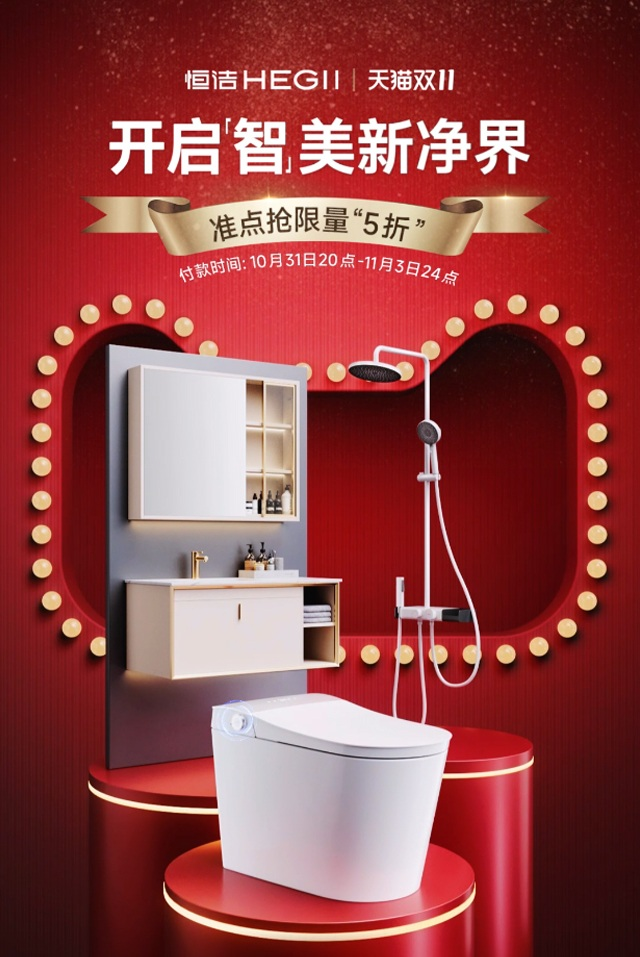
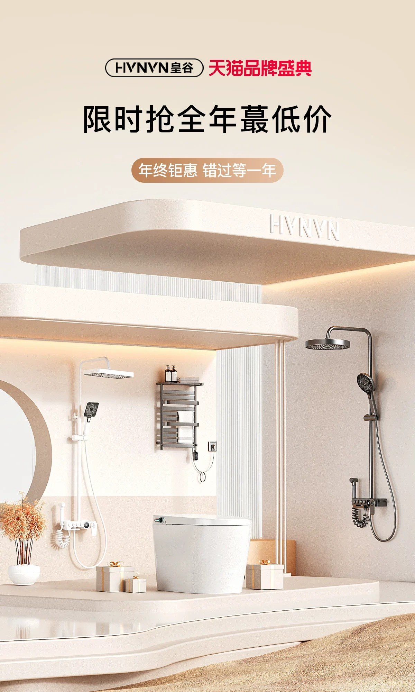
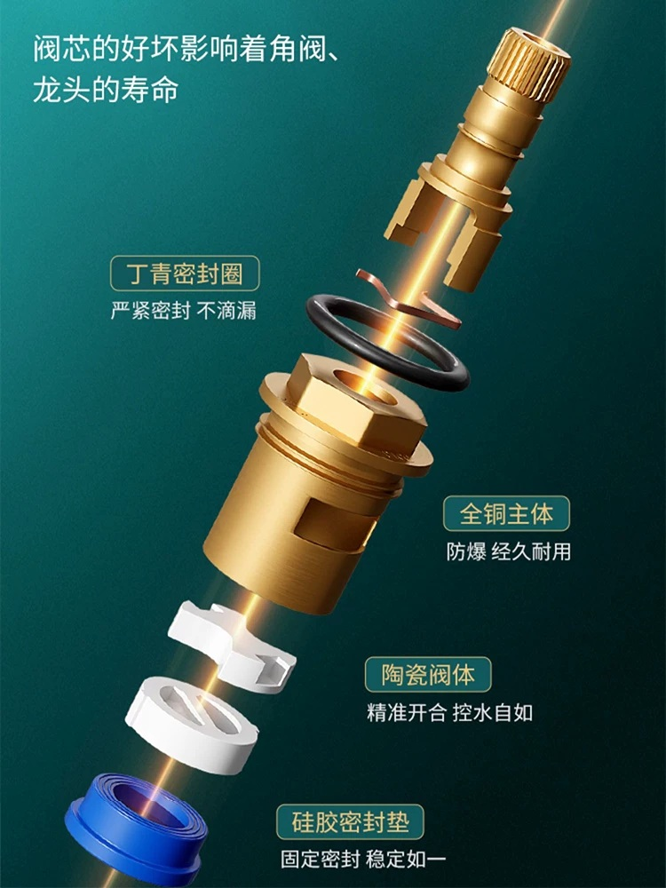

# 2_商品专题海报 · 家装建材 代表图

本组按商品呈现、信息组织和动线选取不同结构。占比为目测描述，不是排版指令。

## 2-补006：卫浴成套

用途：活动促销；参考角色：整图布局参考；标签：多商品组合;前后景分层;中心英雄

可借鉴：前景马桶、后景柜与淋浴分层，顶部主题与灯框建立活动场

不适合照搬：舞台不是安装空间，成套商品和折扣不能照搬

## 2-补044：卫浴成套

用途：活动促销；参考角色：整图布局参考；标签：场景叙事;前后景分层;留白构图

可借鉴：用连续台阶和横向顶板组织建筑空间，产品分布有高低关系

不适合照搬：镜面、台阶和顶板需重新匹配实装，不能视为固定安装方案

## 2-补构图256：水龙头维修配件／阀芯结构

用途：单品展示；参考角色：局部机制参考；标签：结构拆解;局部特写;斜向动线;信息环绕

可借鉴：零件沿同一轴线分离，旁边标签对应密封圈、主体、陶瓷件，读者可顺着装配关系阅读

不适合照搬：原投放平台及版位未核实；爆炸图必须依据真实结构，材质、耐用性和密封功效不能继承
