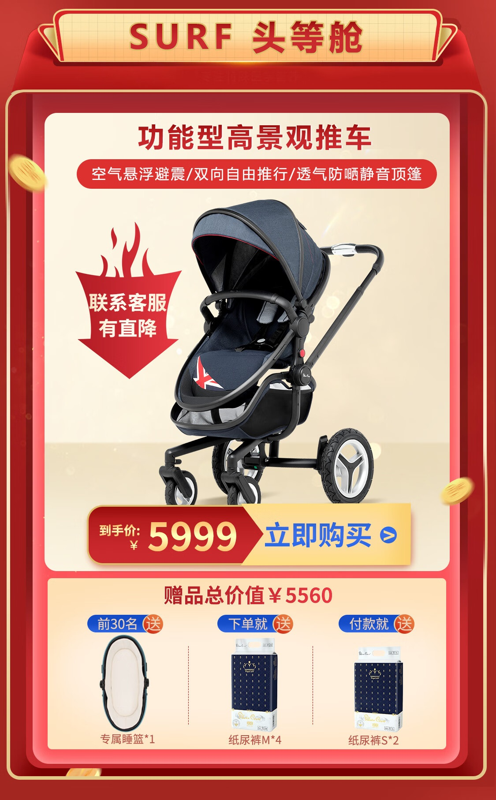
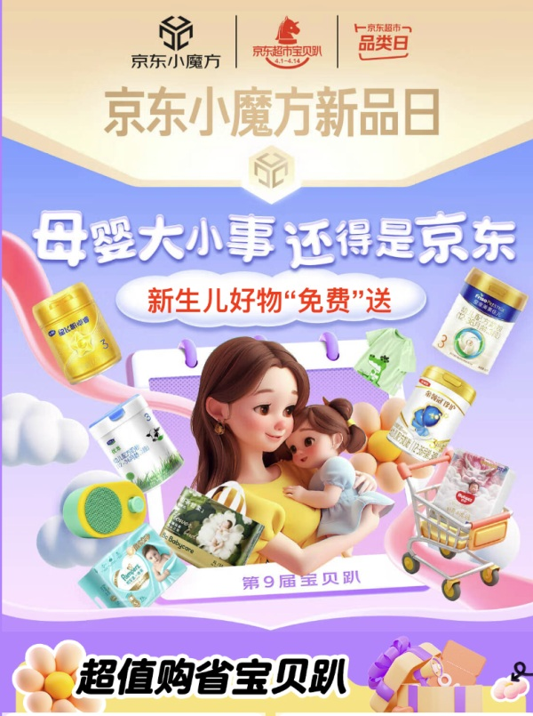
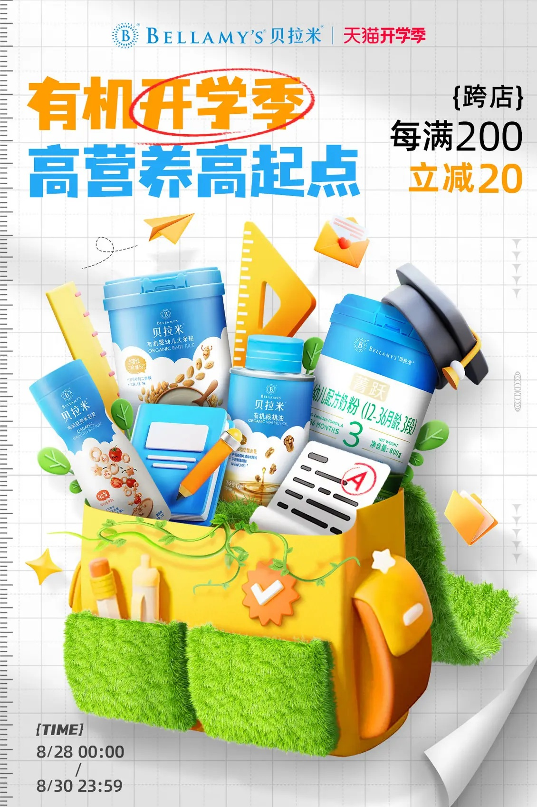

# 2_商品专题海报 · 母婴玩具 代表图

本组按商品呈现、信息组织和动线选取不同结构。占比为目测描述，不是排版指令。

## 2-060：婴儿推车

用途：活动促销；参考角色：整图布局参考；标签：中心英雄;上下分区;参数卡片列

可借鉴：完整推车保持轮廓，下方赠品做独立三栏，不与车架叠合

不适合照搬：礼赠数量、适龄与安全性能不应从参考继承

## 2-061：母婴综合

用途：店铺综合图；参考角色：整图布局参考；标签：人物互动;多商品组合;场景叙事

可借鉴：母婴关系居中，商品绕外围形成生活清单，信息只在上下

不适合照搬：综合图不能证明单品配方、适龄或婴儿使用效果

## 2-062：婴童营养品

用途：活动促销；参考角色：整图布局参考；标签：多商品组合;场景叙事;非对称构图

可借鉴：罐装产品与文具错位堆叠，把开学场景转成主题线索

不适合照搬：奶粉段数、罐数与营养功能不能照搬；文具不默认随赠
