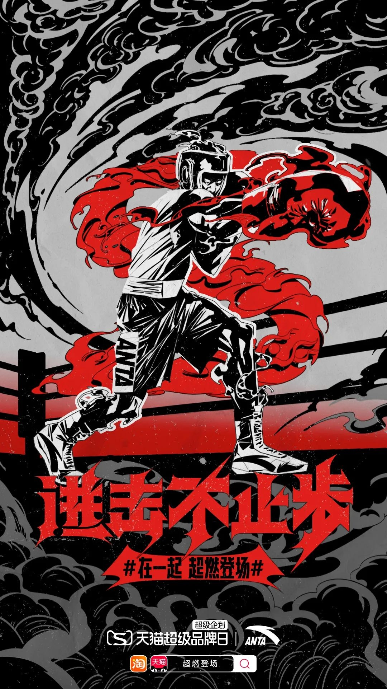
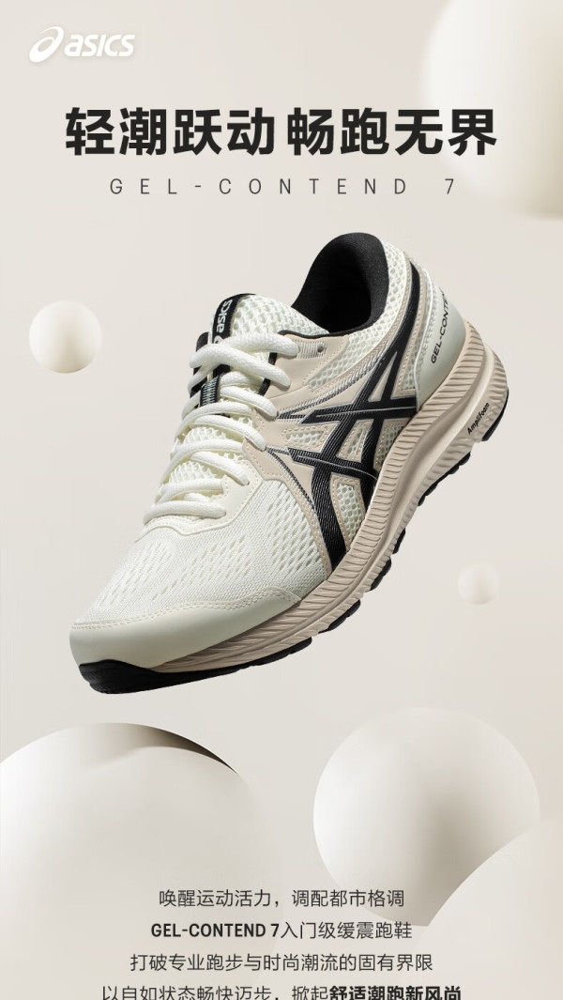
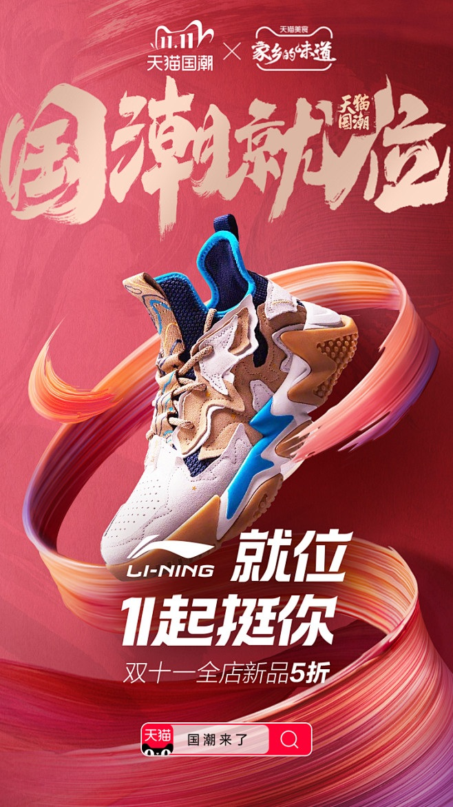

# 2_商品专题海报 · 运动户外 代表图

本组按商品呈现、信息组织和动线选取不同结构。占比为目测描述，不是排版指令。

## 2-059：运动服饰品牌

用途：品牌形象；参考角色：整图布局参考；标签：人物互动;场景叙事;字体主导

可借鉴：动作从左下推向右上，红色主题落在动作下方形成力度

不适合照搬：插画不能代替衣服版型和材料证据；品牌精神非性能参数

## 2-080：跑鞋

用途：单品展示；参考角色：整图布局参考；标签：中心英雄;非对称构图;留白构图

可借鉴：斜向鞋体保留鞋面和中底，顶部短标题与底部说明利用两端留白

不适合照搬：抽象球不证明缓震，性能文案须新商品证据

## 2-082：篮球鞋

用途：活动促销；参考角色：整图布局参考；标签：非对称构图;中心英雄;字体主导

可借鉴：书法占上部，鞋与环绕丝带形成中部旋转，底部短句收束

不适合照搬：丝带和字体不能原样复用；悬浮不宜用于功能结构说明
