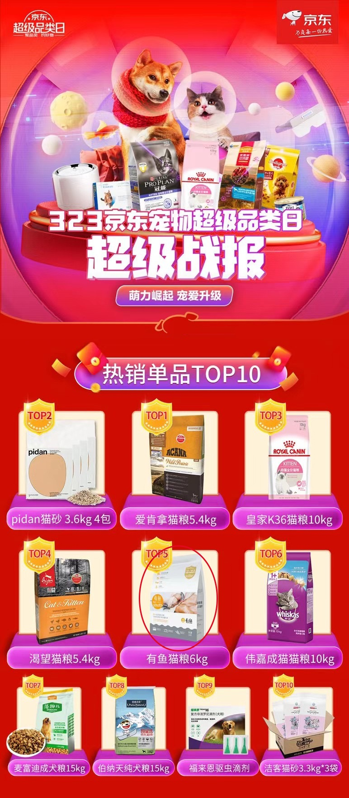
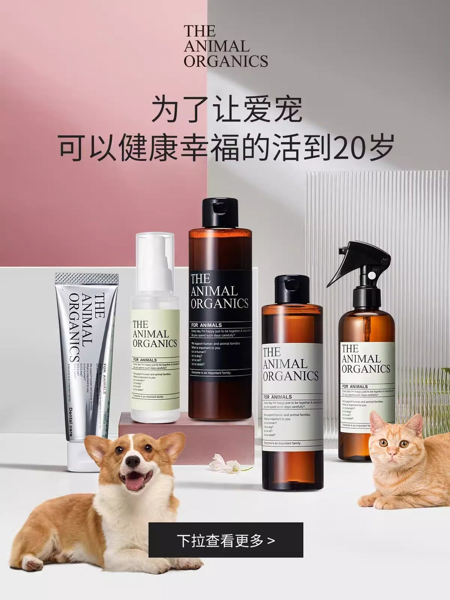
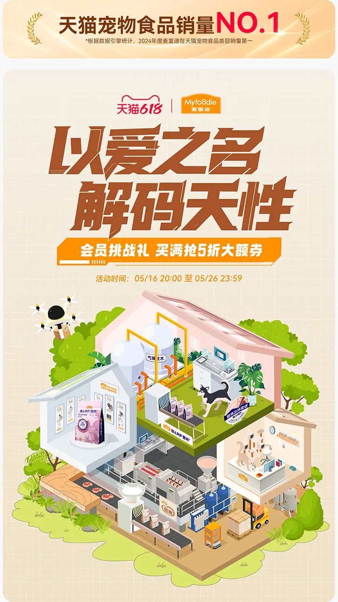

# 2_商品专题海报 · 宠物用品 代表图

本组按商品呈现、信息组织和动线选取不同结构。占比为目测描述，不是排版指令。

## 2-021：宠物食品综合

用途：店铺综合图；参考角色：整图布局参考；标签：参数卡片列;多商品组合;上下分区

可借鉴：上方品牌主题与下方规则化商品格分开，让多品牌信息有索引

不适合照搬：排名不代表品质保证；不可当某一粮袋的参数或价格图

## 2-024：宠物护理

用途：品牌形象；参考角色：整图布局参考；标签：多商品组合;人物互动;前后景分层

可借鉴：高低瓶罐形成层次，犬猫退到前景两角，主张在留白中间

不适合照搬：长寿主张不能沿用；犬猫姿态不证明护理功效

## 2-025：宠物食品与生活

用途：活动促销；参考角色：整图布局参考；标签：场景叙事;字体主导;多商品组合

可借鉴：下半部剖面房屋按使用场景分区，上部主题集中不散落房间

不适合照搬：剖面不是实际房屋或套装配置；营养与排名不得继承
