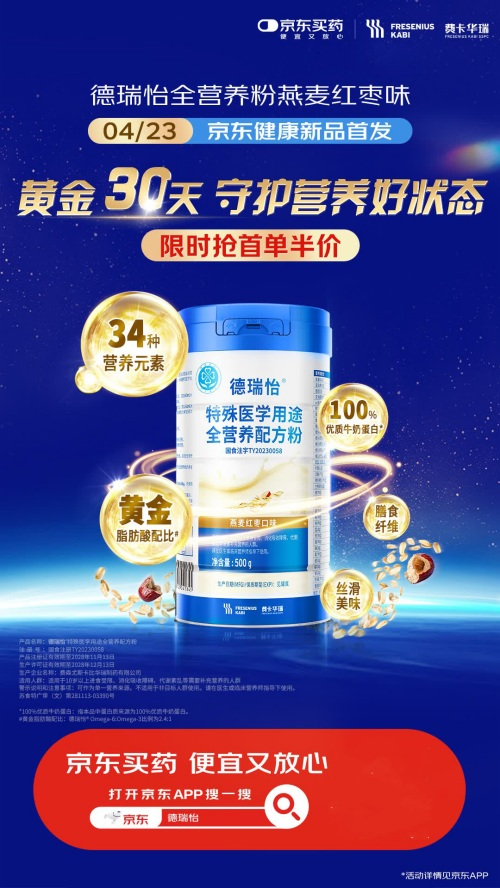
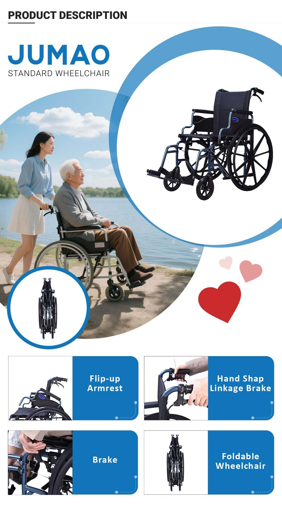
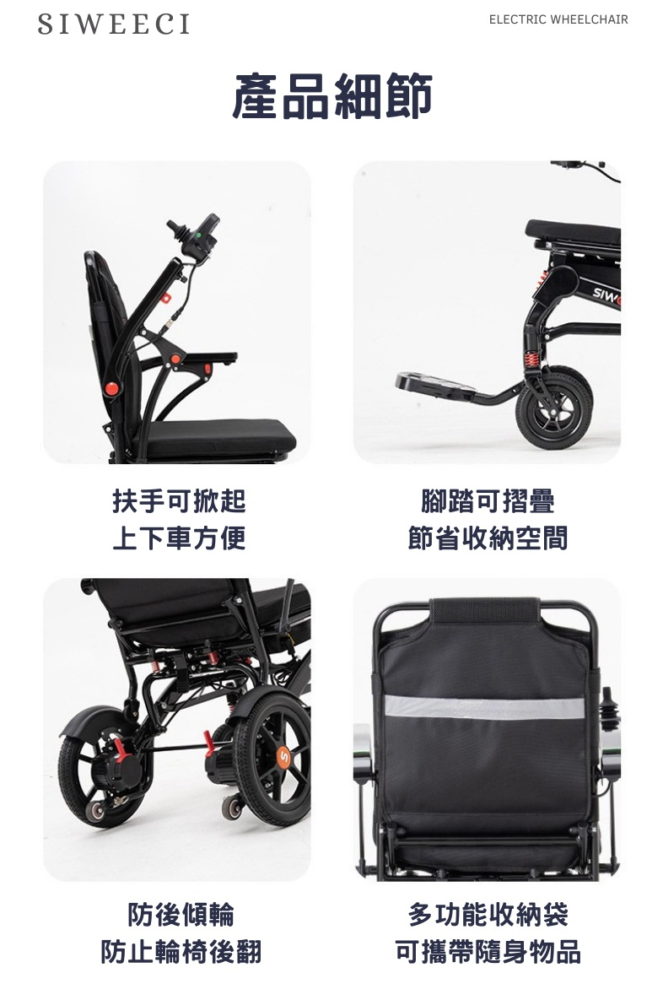

# 2_商品专题海报 · 医疗健康 代表图

本组按商品呈现、信息组织和动线选取不同结构。占比为目测描述，不是排版指令。

## 2-003：营养品／特殊医学用途食品

用途：活动促销；参考角色：整图布局参考；标签：中心英雄;参数卡片列;上下分区

可借鉴：单罐周围少量圆形证据标签，下方入口独立，包装识别优先

不适合照搬：医学营养参数与康复功能必须重新核实

## 2-004：健康服务／药品综合

用途：品牌形象；参考角色：整图布局参考；标签：人物互动;场景叙事;字体主导

可借鉴：倾斜标题跨上半部，人物动作承接情绪，底部平台入口单独分区

不适合照搬：不是监测设备结构图，情绪不能当成疗效证据

## 2-补构图191：大件行动辅助用品／轮椅生活场景与结构

用途：单品展示；参考角色：使用关系参考；标签：场景叙事;人物互动;完整与细节并置;卡片矩阵

可借鉴：上部生活情境建立人与轮椅关系，整车圆框补清车架，下方按部件分卡说明

不适合照搬：厂商说明图并非国内平台原广告；人物、结构、承重参数与折叠方法不能继承

## 2-补构图192：大件行动辅助用品／轮椅操作细节

用途：单品展示；参考角色：局部机制参考；标签：局部特写;卡片矩阵;结构展示

可借鉴：每张卡只解释一个部件，动作状态直接对应短说明，阅读由上到下两列

不适合照搬：缺完整车架锚点；不能把别款的翻起结构、防倾轮和袋子视为标配
