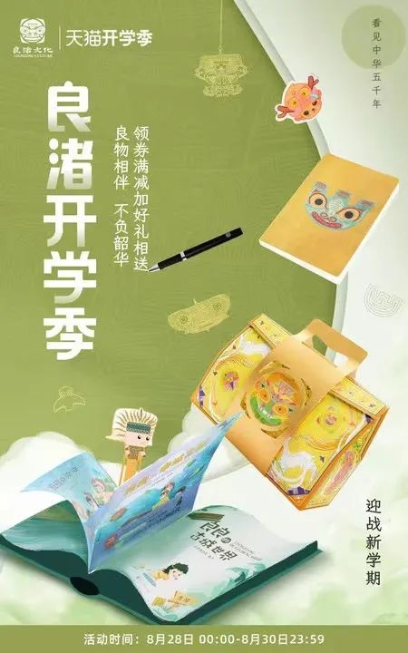
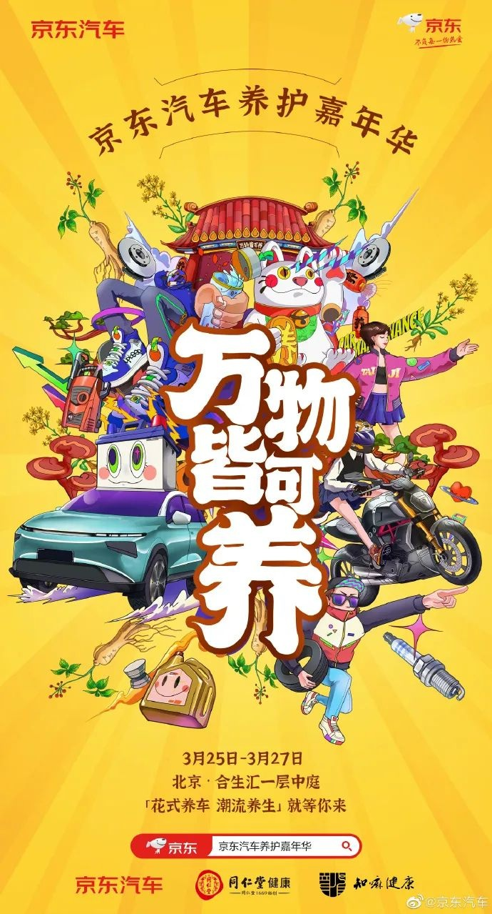
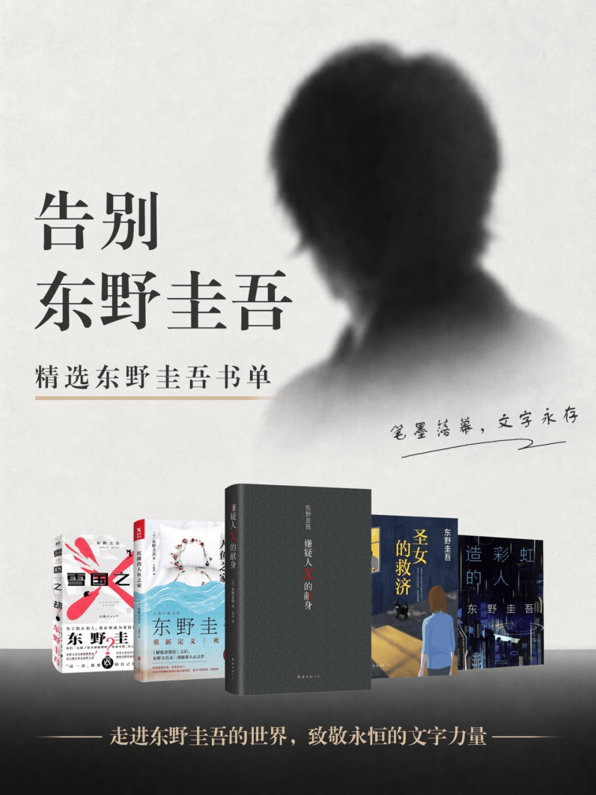

# 2_商品专题海报 · 汽车用品与图书文创 代表图

本组按商品呈现、信息组织和动线选取不同结构。占比为目测描述，不是排版指令。

## 2-053：文创文具礼盒

用途：活动促销；参考角色：整图布局参考；标签：俯视陈列;非对称构图;字体主导

可借鉴：竖排标题占左侧，翻开书册与完整礼盒沿对角线组织

不适合照搬：文化纹样、博物馆资产和礼盒内容不能沿用

## 2-补054：汽车养护综合

用途：品牌形象；参考角色：整图布局参考；标签：字体主导;多商品组合;场景叙事

可借鉴：纵向大字形成中轴，车与工具绕两侧，让品牌活动先被读到

不适合照搬：综合插画不能说明一瓶机油的参数、适配或配置

## 2-补构图173：作者系列图书

用途：品牌形象；参考角色：整图布局参考；标签：字体主导;人物展示;多商品组合;非对称构图

可借鉴：上部作者剪影与大标题先传达阅读主题，下部完整书列说明具体书目

不适合照搬：不能把纪念作者的主题用于普通促销，肖像版权和书目事实不可继承
