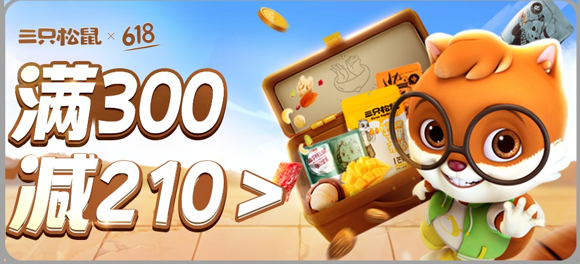
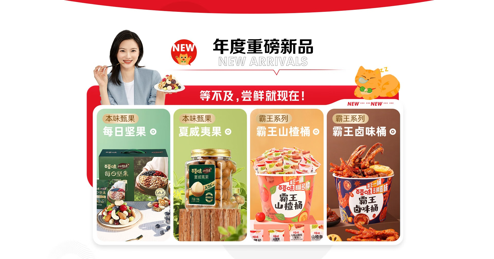
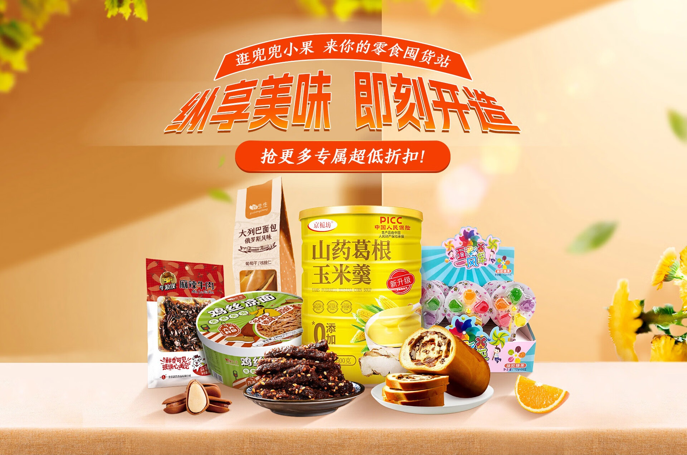

# 3_详情页头图与横幅 · 食品零食 代表图

本组按商品呈现、信息组织和动线选取不同结构。占比为目测描述，不是排版指令。

## 3-094：坚果零食礼盒

用途：活动促销；参考角色：整图布局参考；标签：字体主导;非对称构图;IP互动

可借鉴：用左侧大字吸引视线，再由右侧开箱动作解释购买对象

不适合照搬：不适合要求看清每袋口味的普通单品首屏，优惠规则不能继承

## 3-095：多款包装食品

用途：店铺综合图；参考角色：整图布局参考；标签：多商品组合;卡片矩阵;字体主导

可借鉴：顶部一个主题统领，下部等宽卡片承担不同商品入口

不适合照搬：导航型结构不能当一款食品的细节说明

## 3-098：零食组合

用途：品牌形象；参考角色：整图布局参考；标签：场景叙事;多商品组合;中心英雄

可借鉴：用低位产品群承托上方标题，包装前后高低建立层次

不适合照搬：展示数量和包装品牌不能照搬，细小口味字不宜直接沿用
