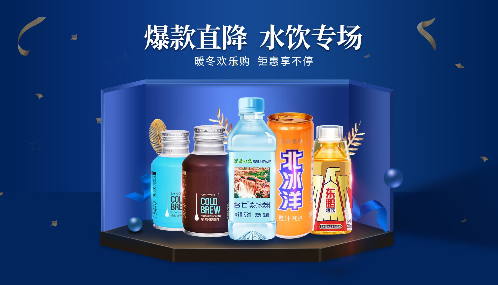
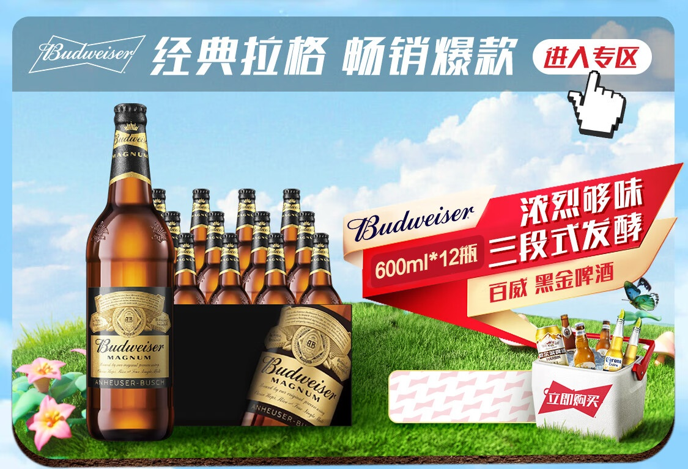
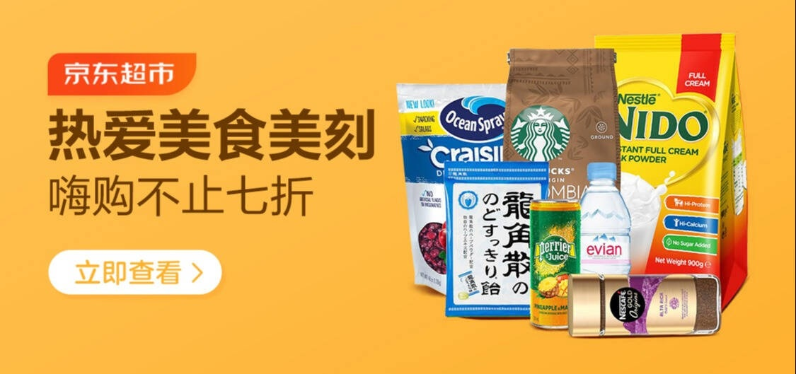

# 3_详情页头图与横幅 · 酒水饮料 代表图

本组按商品呈现、信息组织和动线选取不同结构。占比为目测描述，不是排版指令。

## 3-086：多款饮料

用途：活动促销；参考角色：整图布局参考；标签：多商品组合;中心英雄;舞台陈列

可借鉴：不同高矮瓶型沿同一台面排开，标题保留在上方空区

不适合照搬：多品牌合集不适合只讲单瓶独特卖点

## 3-089：瓶装啤酒与整箱

用途：活动促销；参考角色：整图布局参考；标签：非对称构图;完整与细节并置;字体主导

可借鉴：左侧放大瓶身用于识别，中部整箱解释购买单位，右侧只承担优惠

不适合照搬：广告中的赠送数量、折扣和酒类品牌资产不可继承

## 3-090：进口饮料与食品组合

用途：店铺综合图；参考角色：整图布局参考；标签：左右分栏;多商品组合

可借鉴：一侧集中概括主题，另一侧按前后高低陈列多包装

不适合照搬：跨食品与酒水的混合商品不能用来描述单瓶成分
