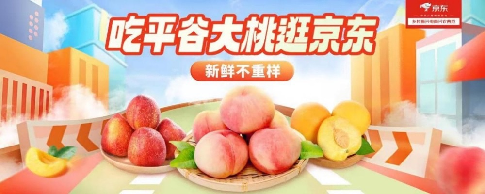
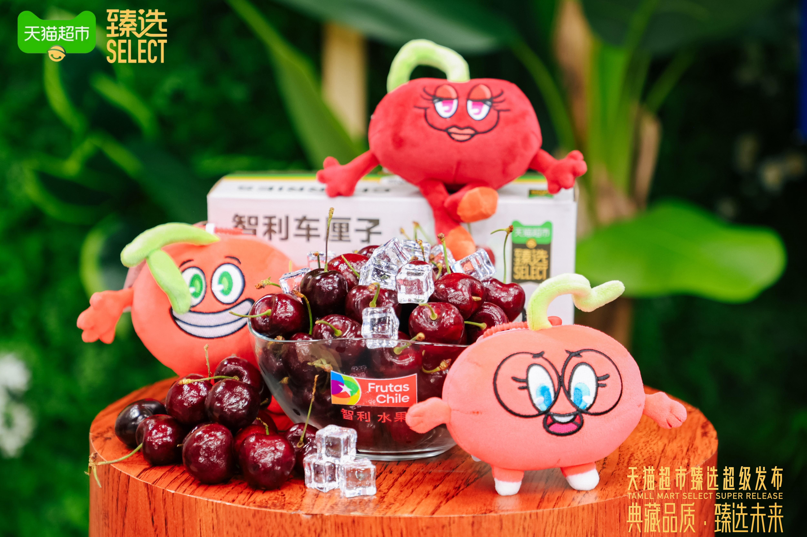

# 3_详情页头图与横幅 · 生鲜农产品 代表图

本组按商品呈现、信息组织和动线选取不同结构。占比为目测描述，不是排版指令。

## 3-补064：水果活动集合

用途：活动促销；参考角色：整图布局参考；标签：字体主导;IP互动;非对称构图

可借鉴：让活动数字建立第一层级，再用边缘水果提示活动品类

不适合照搬：不适合强调品相、规格、产地的普通生鲜展示

## 3-补072：桃子鲜果礼篮

用途：单品展示；参考角色：整图布局参考；标签：中心英雄;多商品组合;场景叙事

可借鉴：完整礼篮建立购买形态，前景切果补充内部质地

不适合照搬：果肉颜色、包装数量和背景所暗示产地均须替换为真实资料

## 3-补构图101：车厘子礼盒与鲜果

用途：品牌形象；参考角色：整图布局参考；标签：中心英雄;IP互动;场景叙事

可借鉴：盒装、散果、盘装三个层次解释购买形态与食用品相，木墩提供实物落点

不适合照搬：产国和品牌不能从画面继承，IP形象及果品大小须替换
