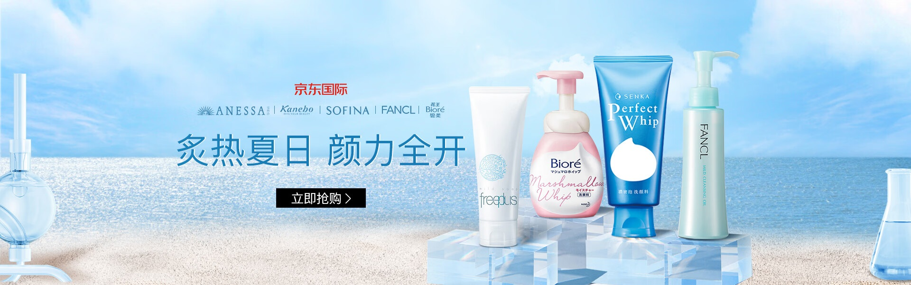
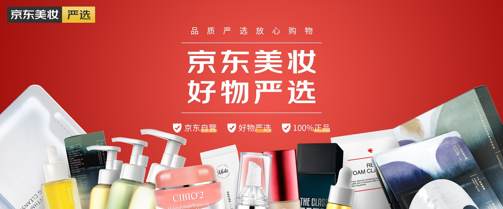
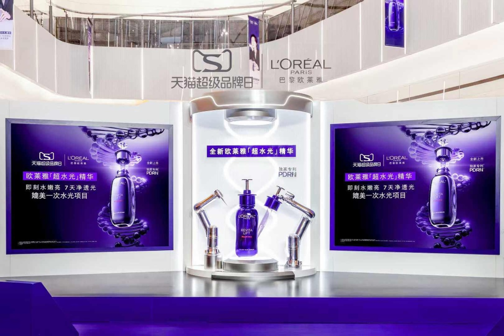

# 3_详情页头图与横幅 · 美妆护肤 代表图

本组按商品呈现、信息组织和动线选取不同结构。占比为目测描述，不是排版指令。

## 3-064：防晒护肤套组

用途：品牌形象；参考角色：整图布局参考；标签：左右分栏;多商品组合;舞台陈列

可借鉴：左文右物保持清楚分工，透明台阶让多瓶标签错位可见

不适合照搬：场景只能提供季节语境，不能据此声称防晒等级或防水功效

## 3-065：美妆多品类集合

用途：活动促销；参考角色：整图布局参考；标签：字体主导;多商品组合;局部特写

可借鉴：顶部大标题与底部裁切商品群形成上下层级

不适合照搬：不适合需要识别完整瓶型、具体规格的单品介绍

## 3-068：精华护肤单品

用途：品牌形象；参考角色：整图布局参考；标签：中心英雄;舞台陈列;场景叙事

可借鉴：中央真实商品负责识别，两侧展示面扩展主题，形成由边向中的聚焦

不适合照搬：不能把虚拟展台理解为真实认证展示，辅助海报不宜塞满细字
