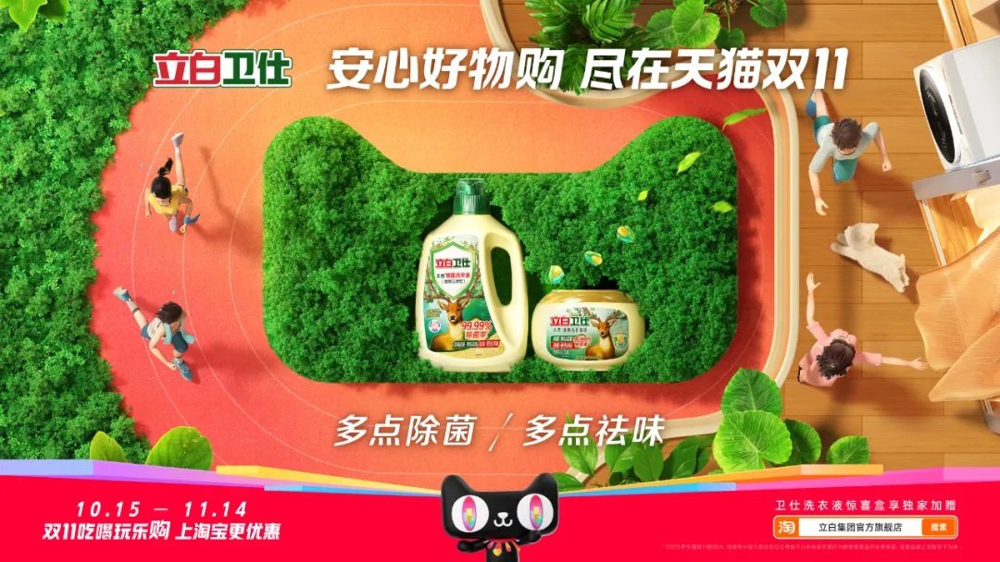
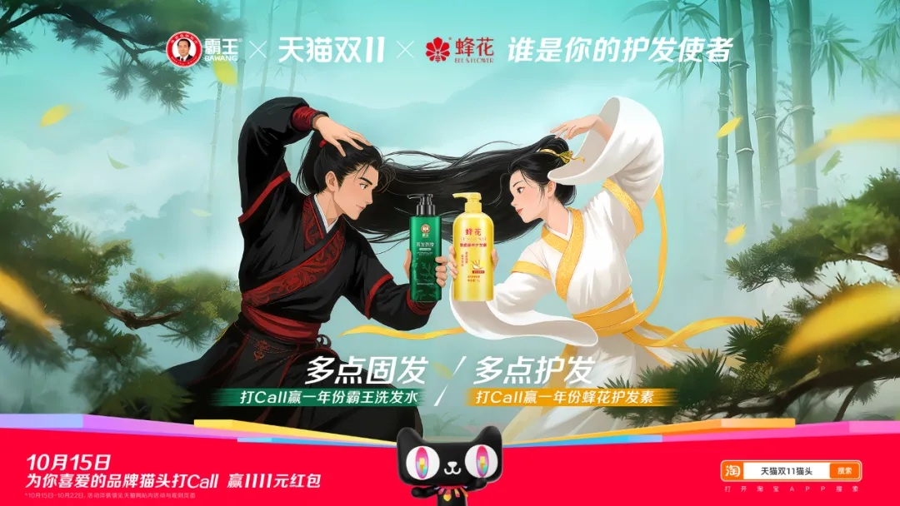
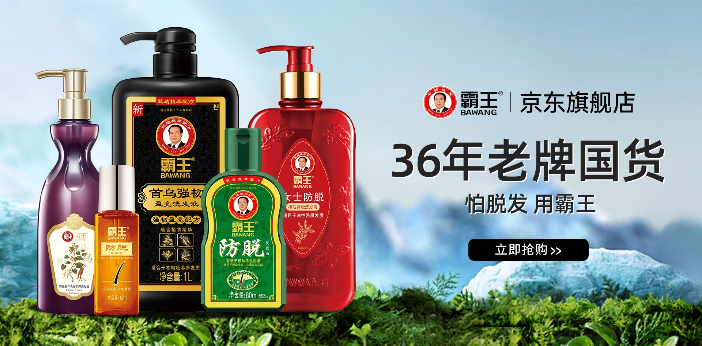

# 3_详情页头图与横幅 · 个护清洁 代表图

本组按商品呈现、信息组织和动线选取不同结构。占比为目测描述，不是排版指令。

## 3-034：洗衣清洁用品

用途：活动促销；参考角色：整图布局参考；标签：俯视陈列;场景叙事;多商品组合

可借鉴：将高瓶当作景观中心，用微缩人物和路径组织阅读方向

不适合照搬：微缩夸张场景不适合解释真实容量和安全使用方法

## 3-072：洗发护理用品

用途：品牌形象；参考角色：整图布局参考；标签：人物互动;中心英雄;场景叙事

可借鉴：左右人物把视线导向中间商品，品牌和口号分别在上下区

不适合照搬：不能继承人物IP、联名关系或未经证实的功效

## 3-补构图120：洗发护理系列

用途：品牌形象；参考角色：整图布局参考；标签：左右分栏;多商品组合;场景叙事

可借鉴：把不同瓶型集中在一侧露出标签，另一侧只放一条主题和入口

不适合照搬：植物背景不能作为成分证据，功效、年份和品牌资产不可继承
