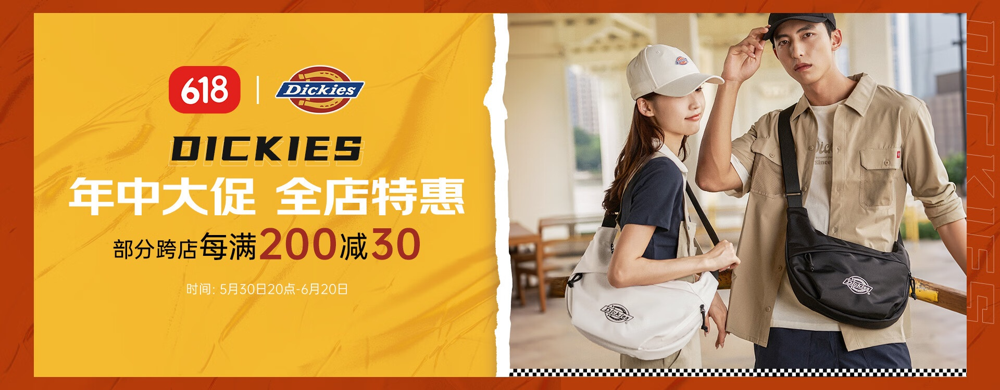
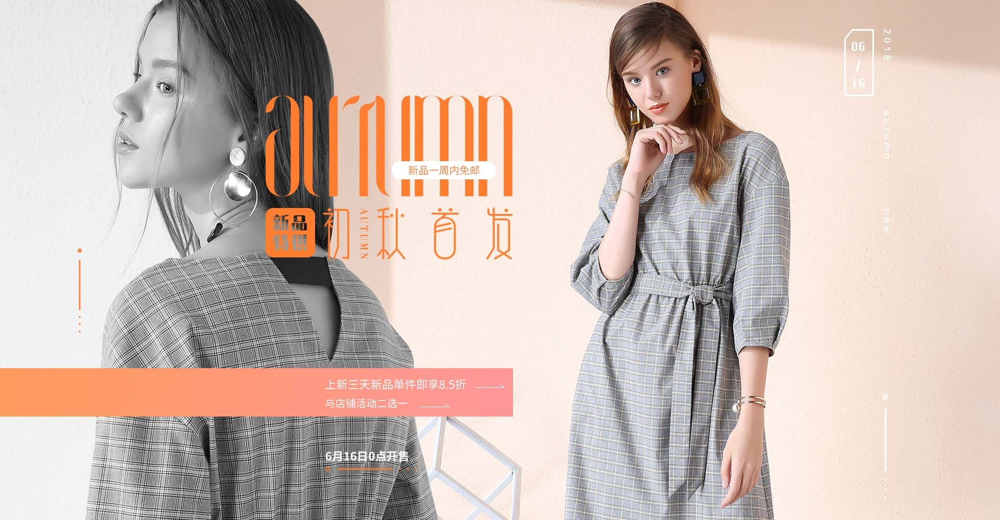
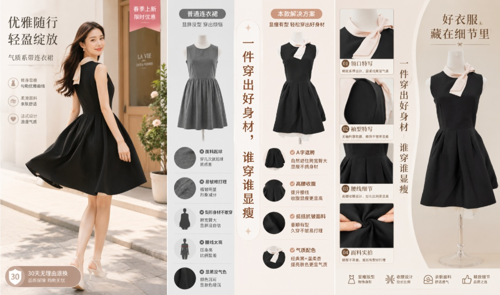

# 3_详情页头图与横幅 · 服饰内衣 代表图

本组按商品呈现、信息组织和动线选取不同结构。占比为目测描述，不是排版指令。

## 3-052：工装服饰

用途：活动促销；参考角色：整图布局参考；标签：左右分栏;人物互动

可借鉴：右侧街景解释穿着组合，左侧整块信息板确保文字可读

不适合照搬：店铺活动优惠不能沿用，模特搭配不能代替单件版型细节

## 3-054：女装外套

用途：品牌形象；参考角色：使用关系参考；标签：完整与细节并置;非对称构图;人物展示

可借鉴：大背部局部展现面料与肩线，另一侧完整穿搭作为识别锚点

不适合照搬：颜色和材质细节必须来自本商品，不能为版式裁掉关键结构

## 3-补构图137：连衣裙版型及做工

用途：单品展示；参考角色：局部机制参考；标签：局部特写;完整与细节并置;卡片矩阵

可借鉴：左侧穿着解释轮廓，中间纽扣领口腰部特写说明结构，右侧完整单件作核对

不适合照搬：原布料、工艺、裙长与细节不能用于别款；密集细字需按实际版位删减
