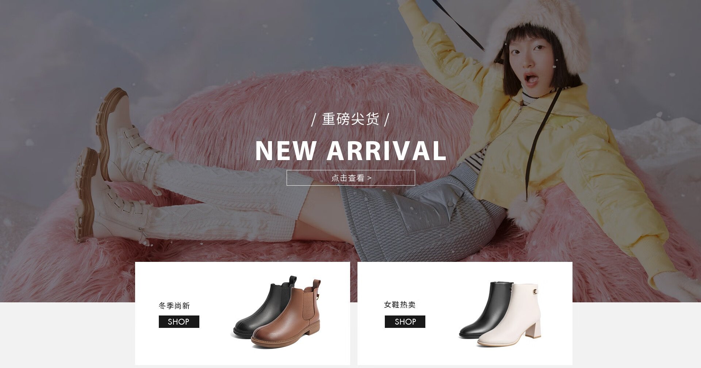
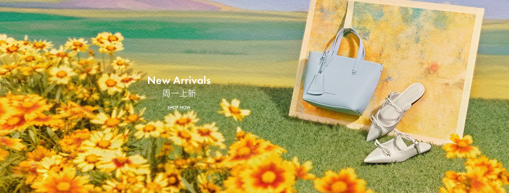
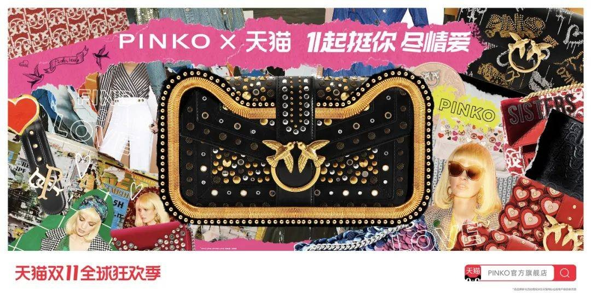

# 3_详情页头图与横幅 · 鞋靴箱包 代表图

本组按商品呈现、信息组织和动线选取不同结构。占比为目测描述，不是排版指令。

## 3-055：女鞋款式集合

用途：店铺综合图；参考角色：整图布局参考；标签：人物展示;卡片矩阵;完整与细节并置

可借鉴：上部穿着氛围吸引注意，下部商品卡解释具体款式

不适合照搬：人物姿态不能代替鞋底与鞋型信息，不能套用品牌文字

## 3-073：女包与女鞋

用途：品牌形象；参考角色：整图布局参考；标签：非对称构图;多商品组合;框中框

可借鉴：用近景花朵压左边，右侧画框聚焦包鞋，标题占中间空区

不适合照搬：花材和场景不能遮住包的轮廓、鞋头与实际细节

## 3-补构图070：装饰女包

用途：品牌形象；参考角色：整图布局参考；标签：中心英雄;局部特写;拼贴叙事

可借鉴：中央完整包保持识别，四周拼贴扩展视觉纹样，文字压在上下条

不适合照搬：拼贴人物与IP不可继承，装饰图案必须来自本商品
