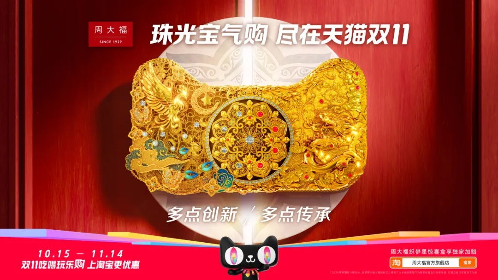
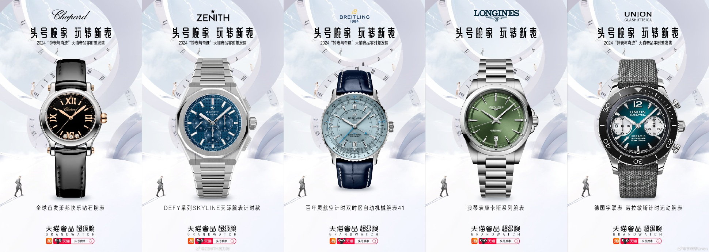
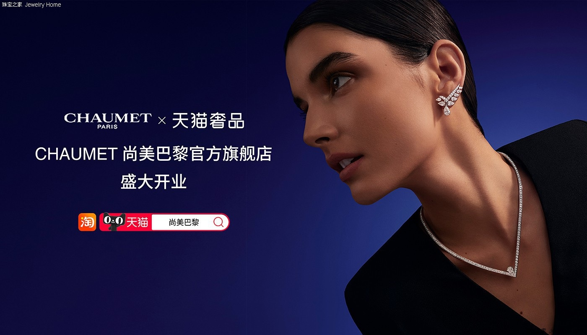

# 3_详情页头图与横幅 · 珠宝钟表 代表图

本组按商品呈现、信息组织和动线选取不同结构。占比为目测描述，不是排版指令。

## 3-056：黄金首饰

用途：品牌形象；参考角色：整图布局参考；标签：中心英雄;局部特写;文化场景

可借鉴：把首饰纹样放大在中央，用上下短文字保持纹样完整阅读

不适合照搬：不能借此判断含金量、工艺或文化授权，实际商品须独立拍摄

## 3-补构图056：多品牌腕表

用途：店铺综合图；参考角色：整图布局参考；标签：卡片矩阵;多商品组合;字体主导

可借鉴：等宽五卡保留每只表完整轮廓，使各品牌入口边界清楚

不适合照搬：不适合单表强调机械细节，品牌和机芯参数不能跨卡混用

## 3-补构图063：项链耳饰佩戴

用途：品牌形象；参考角色：使用关系参考；标签：人物展示;左右分栏;局部特写

可借鉴：右侧肩颈近景显示首饰实际佩戴尺度，左侧短文不覆盖首饰

不适合照搬：代言人、首饰系列、开店信息不可沿用，不能从光影推断宝石品质
