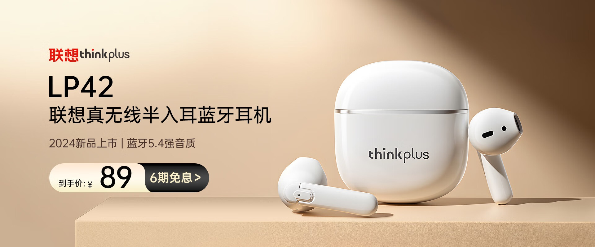
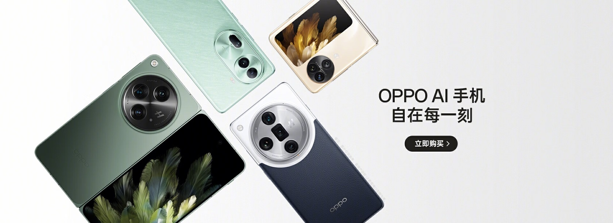
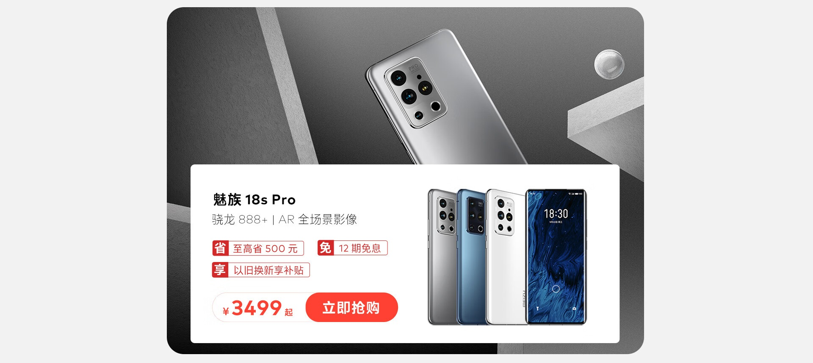

# 3_详情页头图与横幅 · 手机数码 代表图

本组按商品呈现、信息组织和动线选取不同结构。占比为目测描述，不是排版指令。

## 3-035：无线耳机

用途：单品展示；参考角色：整图布局参考；标签：左右分栏;中心英雄

可借鉴：左侧文字按名称到卖点到价格排序，右侧完整耳机盒展示购买对象

不适合照搬：参数、续航和价格必须根据本商品核实

## 3-036：多款手机

用途：店铺综合图；参考角色：整图布局参考；标签：斜向动线;多商品组合;非对称构图

可借鉴：斜向多机阵列形成动线，右侧空区只承接一个主题

不适合照搬：不同机型不能混成单机规格，机身相机数量不可沿用

## 3-038：手机影像单品

用途：单品展示；参考角色：整图布局参考；标签：局部特写;完整与细节并置;非对称构图

可借鉴：大相机模组承担视觉冲击，白卡中的完整手机确认机型与购买对象

不适合照搬：放大不能改镜头结构，摄影性能文字不能从参考继承
