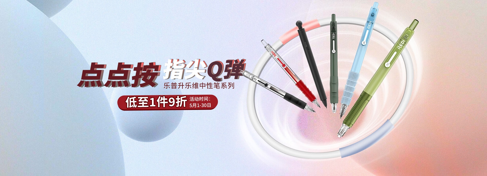
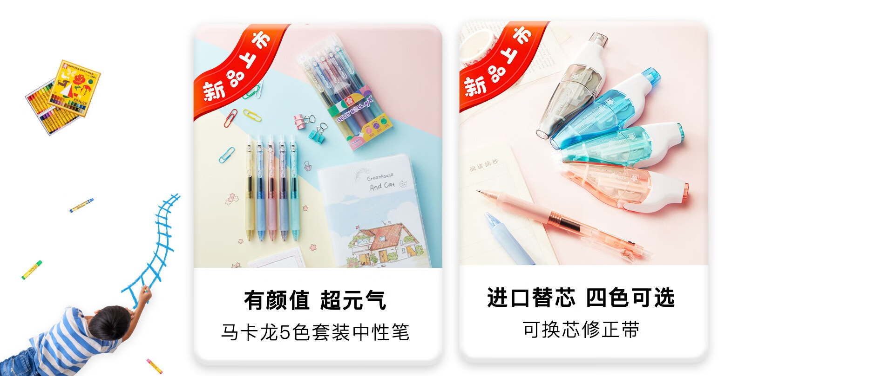

# 3_详情页头图与横幅 · 电脑办公 代表图

本组按商品呈现、信息组织和动线选取不同结构。占比为目测描述，不是排版指令。

## 3-046：书写笔

用途：单品展示；参考角色：整图布局参考；标签：左右分栏;斜向动线;多商品组合

可借鉴：用扇形排列露出笔身颜色与笔帽，左侧留清楚的信息入口

不适合照搬：笔色、笔尖和数量不能随构图随意修改

## 3-047：笔与修正带

用途：店铺综合图；参考角色：整图布局参考；标签：卡片矩阵;人物互动;多商品组合

可借鉴：用等宽双卡分别说明两类文具，其中一张用手部动作解释使用

不适合照搬：两个品类的参数和价格不能合并，手部透视不可失真

## 3-050：学生文具集合

用途：活动促销；参考角色：整图布局参考；标签：场景叙事;人物互动;字体主导;多商品组合

可借鉴：用黑板天然文字面承载主题，下部真实文具独立成排，两侧人物引导视线

不适合照搬：不能借课堂场景暗示教育效果，整套数量需核实
