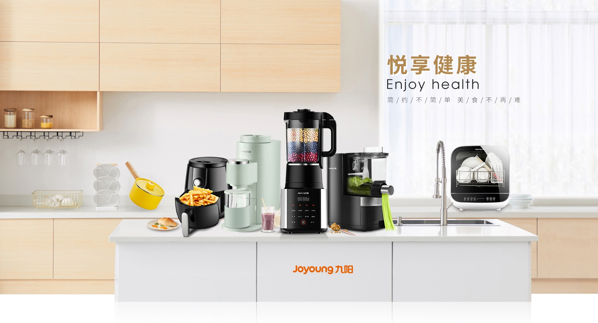
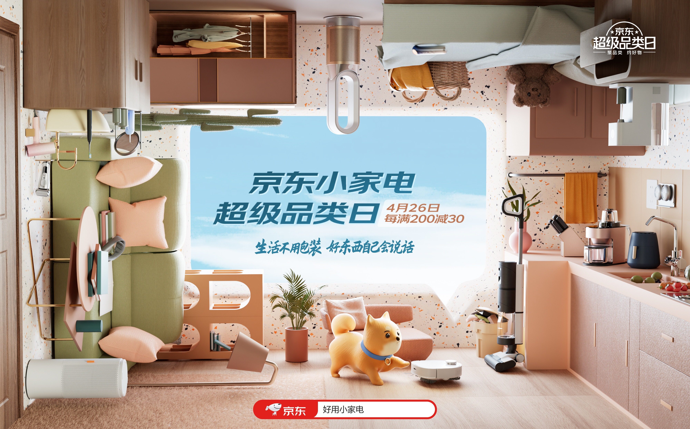
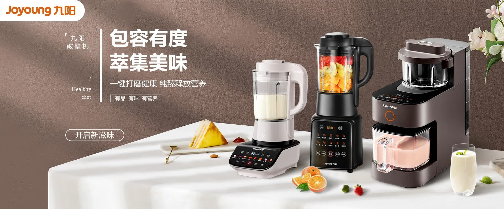

# 3_详情页头图与横幅 · 家用电器 代表图

本组按商品呈现、信息组织和动线选取不同结构。占比为目测描述，不是排版指令。

## 3-009：厨房小家电集合

用途：品牌形象；参考角色：整图布局参考；标签：场景叙事;多商品组合;左右分栏

可借鉴：商品沿连续工作台陈列，右侧墙面空区承载主题

不适合照搬：不能把组合图当单台规格，所有电器插线和尺度须真实

## 3-010：家电与家居集合

用途：品牌形象；参考角色：整图布局参考；标签：场景叙事;非对称构图;框中框

可借鉴：边缘围合商品把视线导向中心文字，适合品牌生活方式主题

不适合照搬：不能用概念透视证明实际安装、尺寸或电器使用安全

## 3-011：厨房料理机系列

用途：单品展示；参考角色：整图布局参考；标签：左右分栏;多商品组合;场景叙事

可借鉴：把机器集中在一侧台面，另一侧按主题到行动入口排列

不适合照搬：系列多款不能写成同一型号，功能与配件需分别核实
