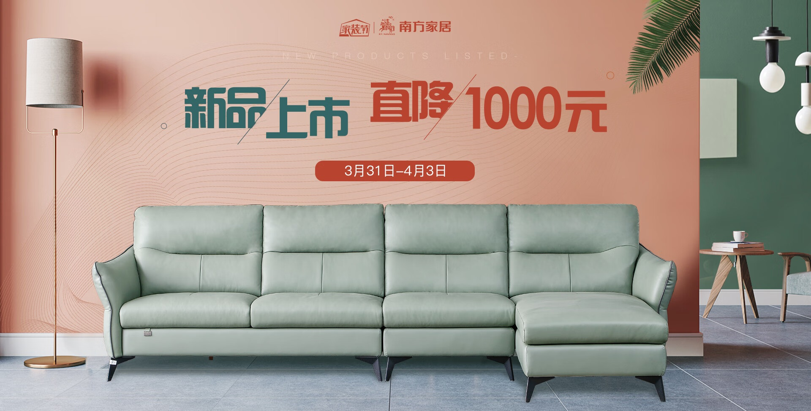
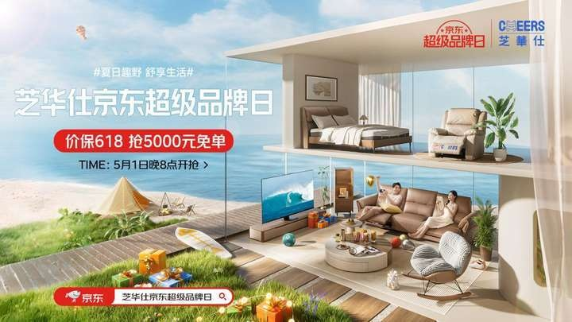
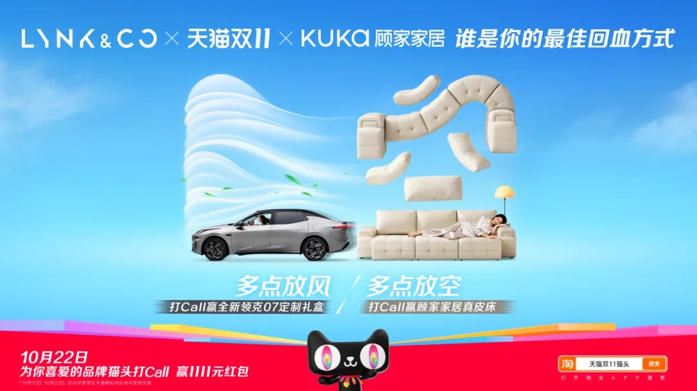

# 3_详情页头图与横幅 · 家居家具 代表图

本组按商品呈现、信息组织和动线选取不同结构。占比为目测描述，不是排版指令。

## 3-025：客厅沙发

用途：活动促销；参考角色：整图布局参考；标签：场景叙事;中心英雄;字体主导

可借鉴：沙发完整正面占下部，标题借墙面留白避免遮坐垫和扶手

不适合照搬：空间比例、尺寸与优惠额度不能继承

## 3-026：家具家居集合

用途：品牌形象；参考角色：整图布局参考；标签：场景叙事;剖面结构;左右分栏

可借鉴：右侧房屋剖面将多个功能区串联，左侧短主题统领生活叙事

不适合照搬：建筑剖面是概念图，不能直接作为实装尺寸或商品结构

## 3-029：组合沙发

用途：品牌形象；参考角色：整图布局参考；标签：结构拆解;非对称构图;场景叙事

可借鉴：完整沙发负责识别，悬浮组件让组合关系可见，道路带出横向动线

不适合照搬：不能继承联名授权，拆分只能按实际组件，不能凭空加结构
