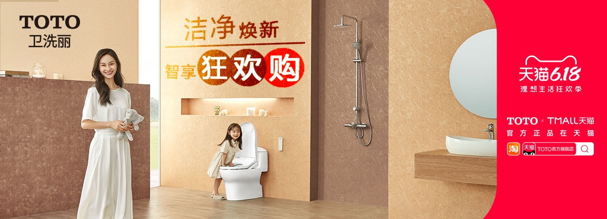
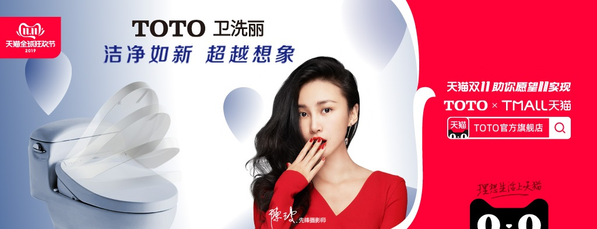
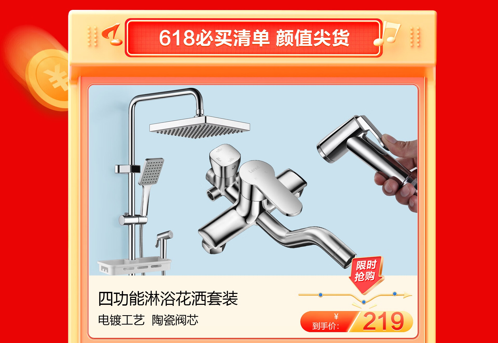

# 3_详情页头图与横幅 · 家装建材 代表图

本组按商品呈现、信息组织和动线选取不同结构。占比为目测描述，不是排版指令。

## 3-补002：卫浴空间与洁具

用途：活动促销；参考角色：整图布局参考；标签：场景叙事;人物展示;左右分栏

可借鉴：用真实卫浴场景承接品牌，右侧独立平台板整理活动信息

不适合照搬：场景图不是全部套装清单，安装间距和代言形象不能沿用

## 3-补041：智能马桶盖

用途：活动促销；参考角色：整图布局参考；标签：结构叠影;人物展示;左右分栏

可借鉴：左侧多角度盖板暗示开合结构，人物与活动区各自分开

不适合照搬：叠影不能当多个赠品，开合角度、功能和代言须核实

## 3-补构图164：花洒水龙头套装与手持件

用途：活动促销；参考角色：局部机制参考；标签：完整与细节并置;人物互动;框中框

可借鉴：用完整立杆作为套装锚点，中间龙头放大、右侧手持演示补充操作关系

不适合照搬：原图周围红边占空间，创作应重排；电子功能、组件数量和价格须核实
