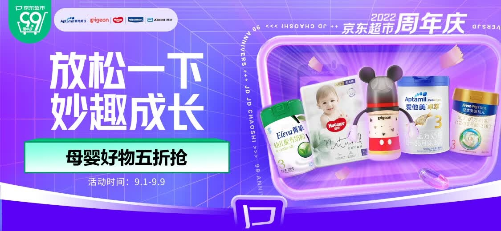
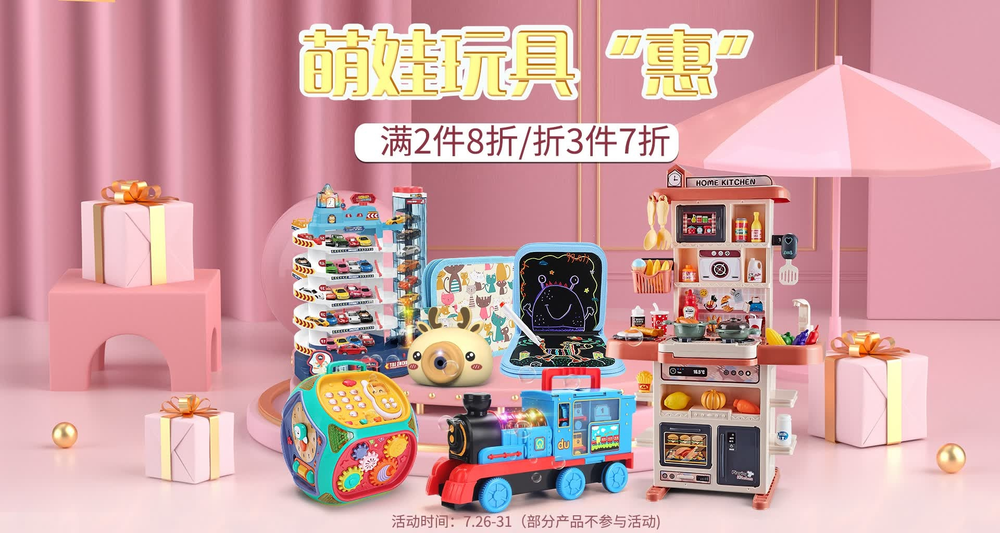

# 3_详情页头图与横幅 · 母婴玩具 代表图

本组按商品呈现、信息组织和动线选取不同结构。占比为目测描述，不是排版指令。

## 3-057：母婴食品与洗护

用途：活动促销；参考角色：整图布局参考；标签：左右分栏;框中框;多商品组合

可借鉴：用单个圆角框集中商品群，让另一侧大标题和规则有明确区隔

不适合照搬：跨品牌活动不能当某一奶粉的功效或规格

## 3-058：儿童玩具集合

用途：活动促销；参考角色：整图布局参考；标签：中心英雄;多商品组合;舞台陈列

可借鉴：不同高矮玩具前后错落成群，上部留出完整标题区

不适合照搬：年龄适用、安全证明和折扣规则不能沿用

## 3-060：母婴出行与家庭用品

用途：品牌形象；参考角色：整图布局参考；标签：场景叙事;IP互动;框中框

可借鉴：大场景框集中家庭互动，上下短句给出出发到回家的阅读线索

不适合照搬：不适合明确介绍一辆推车结构，人物IP和品牌资产不可继承
